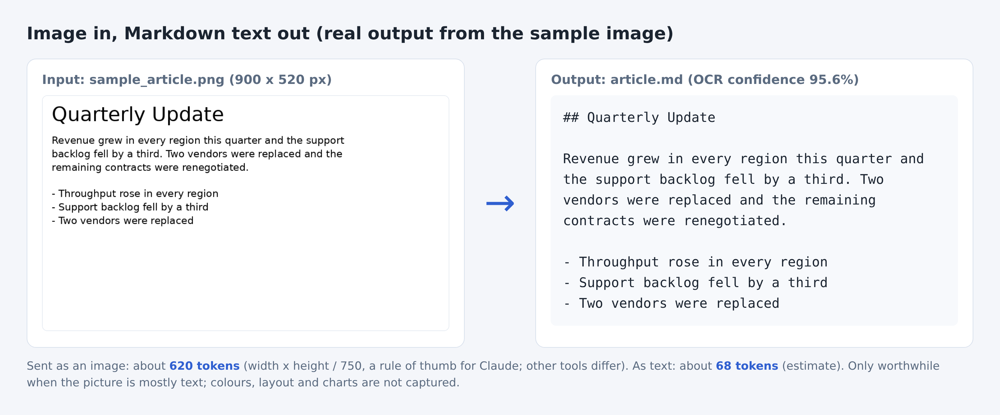
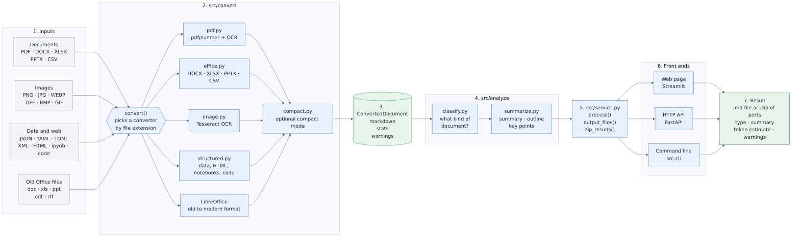
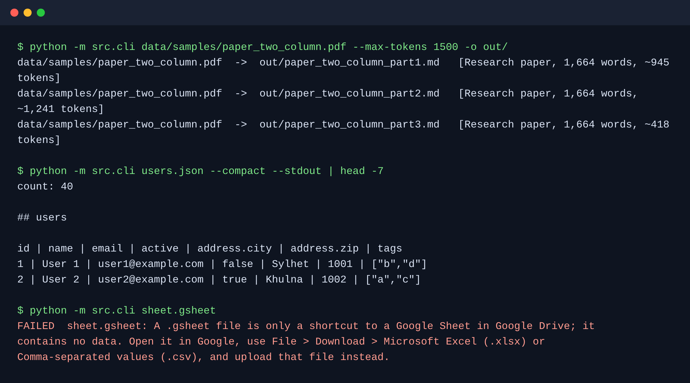
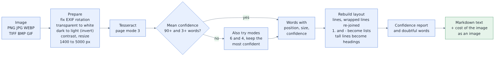
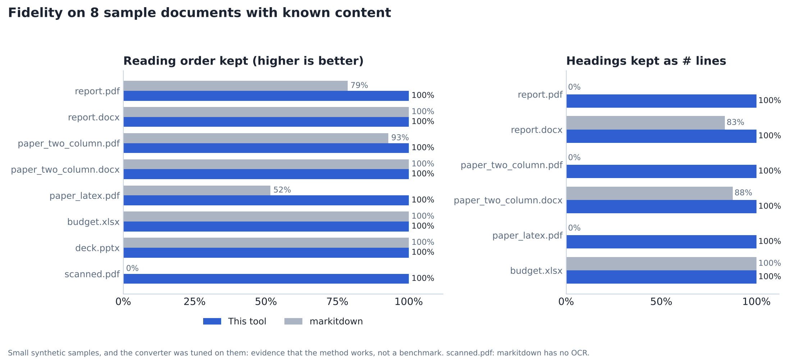

<!--
PORTFOLIO PAGE. Source of truth is README.md; this file is the trimmed, story-first version.
Placeholders to fill: <GITHUB-USERNAME>, <AUTHOR NAME>, Live Demo link (none yet), UI screenshots.
-->

# Part B1 - Portfolio overview card

### AI Document Analyst

`Category: AI Tools · Developer Utility` `Status: Working prototype`

Converts PDFs, Office files, images and data files into compact Markdown for AI chats, names the document type and writes a short summary. It runs locally with no API key, so no money is spent on tokens or services.

**Key features**
- PDF layout recovery: headings, two-column order, tables, repeated header removal, OCR fallback
- Image OCR with confidence and doubtful-word reporting
- Compact mode and splitting by token budget
- Summaries that cannot invent numbers

**Tech stack:** Python · pdfplumber · Tesseract · Streamlit · FastAPI · Docker

**Results:** reading order 100% on 3 sample PDFs against 52% to 93% for markitdown; 40-record JSON from 1,412 (minified) to 716 estimated tokens (-49%); 89 tests and 49 corner cases pass. Samples are synthetic.

**Links:** [Code](https://github.com/<GITHUB-USERNAME>/ai-document-analyst) · [Documentation](docs/00_index.md) · Live Demo: not deployed yet

---

# Part B2 - Portfolio details page

## Overview

AI Document Analyst reads a file and produces clean Markdown, a document-type label, a summary with an outline, and a token estimate. Inputs: PDF, DOCX, XLSX, PPTX, CSV, images, JSON, YAML, TOML, XML, HTML, Jupyter notebooks and code.
Three interfaces (web page, command line, HTTP API) share one service layer.

## Problem

Chat tools limit and bill by tokens. Documents are padded with layout noise and structural punctuation, and converting them through a chatbot costs output tokens and uploads private files. A free plan makes that cost visible quickly.

## Solution

A local converter that rebuilds the document's structure and removes what carries no information, while warning about everything it cannot carry over. A second layer classifies the document with explainable keyword scoring and writes an extractive summary, with an optional AI summary that is rejected if it contains numbers absent from the source.

## Architecture

Converters return one shared `ConvertedDocument`; analysis and the three interfaces depend on that type only. Adding a format touches one module and the dispatch table.

## Screenshots

 

<!-- TODO: add Streamlit screenshots (home, result with warnings) after the first local run. -->

## My Contribution

*(Adjust to what was actually written by hand versus adapted; this text is a starting point.)*

- Designed the converter architecture and the shared `ConvertedDocument` interface.
- Implemented PDF layout inference from word geometry: row grouping, heading detection by font size, two-column gutter detection, ruled and rule-only tables, header and footer removal.
- Built the image pipeline: preparation, multi-mode OCR selection, line and list reconstruction, confidence reporting.
- Added data-file rendering (record lists to tables), compact mode and token-budget splitting.
- Wrote the evaluation against markitdown, the 49-case corner-case script, 89 unit tests and the documentation set.

## Challenges and learnings

| Challenge | What happened | Learning |
|---|---|---|
| Two-column PDFs | Lines from both columns interleaved | Layout has to be inferred from geometry; a gutter histogram fixed reading order |
| OCR merged separate lines | A wrap rule joined short label lines | A guard for label-like lines and a right-edge threshold of 0.88 fixed it; tests on generated inputs found it |
| Misleading token savings | Comparing with indented JSON flattered the result | Pick the fair baseline (minified JSON) and state the estimate's limits |
| Hidden loss of content | Silent drops erode trust | Every omission (pictures, headers, truncation) becomes a warning |
| Tuning on samples | Rules fit the sample files | Synthetic samples are a regression suite, not proof of real-world accuracy; the docs say so |

## Detailed results

| Measure | This tool | markitdown | Note |
|---|---|---|---|
| Reading order, report / two-column / LaTeX-style PDFs | 100% / 100% / 100% | 79% / 93% / 52% | Synthetic samples |
| Headings recovered as `#`, 3 PDFs | 22 of 22 | 0 of 22 | markitdown does not infer PDF headings |
| Scanned PDF word recall | 99.1% | no text | Clean synthetic scan; markitdown has no OCR |
| DOCX word recall and order | 100% / 100% | 100% / 100% | Near tie; headings 6/6 and 8/8 versus 5/6 and 7/8 |
| 40-record JSON, estimated tokens | 2,600 / 1,412 / 822 / 716 | - | Indented / minified / readable / readable + compact |
| Tests | 89 unit tests, 49 corner cases | - | Linux only |

Not measured: savings against any chatbot's own file reader; real-document accuracy; AI summary quality with a real model.

## Future improvements

- Hosted free demo and UI screenshots.
- Real-document evaluation set and a real tokenizer option.
- Borderless PDF tables, DOCX headers and footnotes, right-to-left text tests.
- Authentication for the API.

---

**Writing rule for this page:** README first, then trim. Every number above comes from `reports/fidelity.json`, `scripts/corner_cases.py` or the token example in [docs/08](docs/08_testing_and_reproduction.md).
