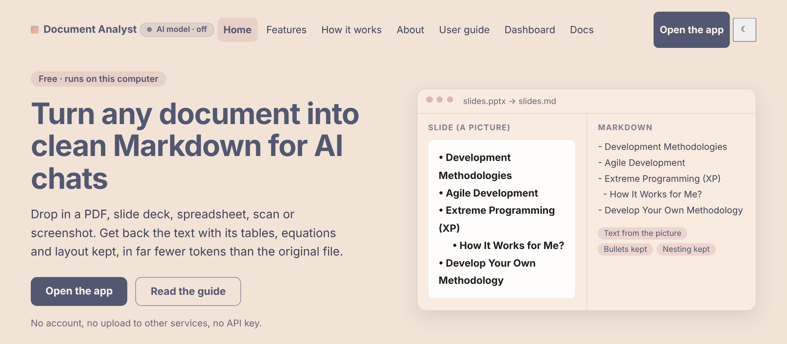
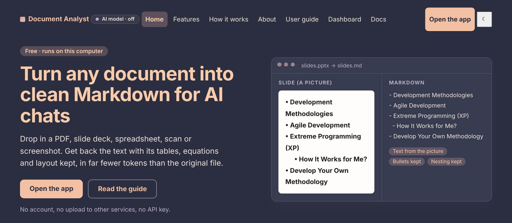
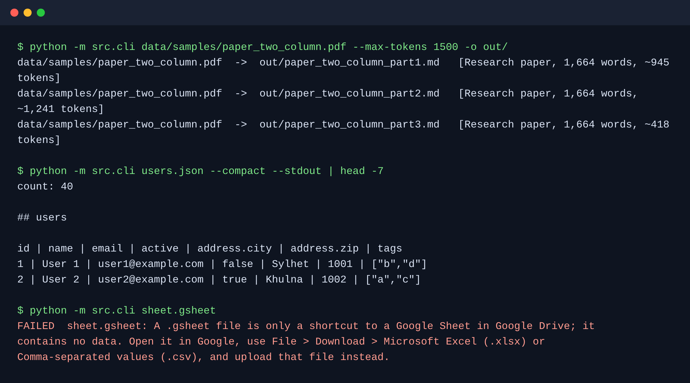
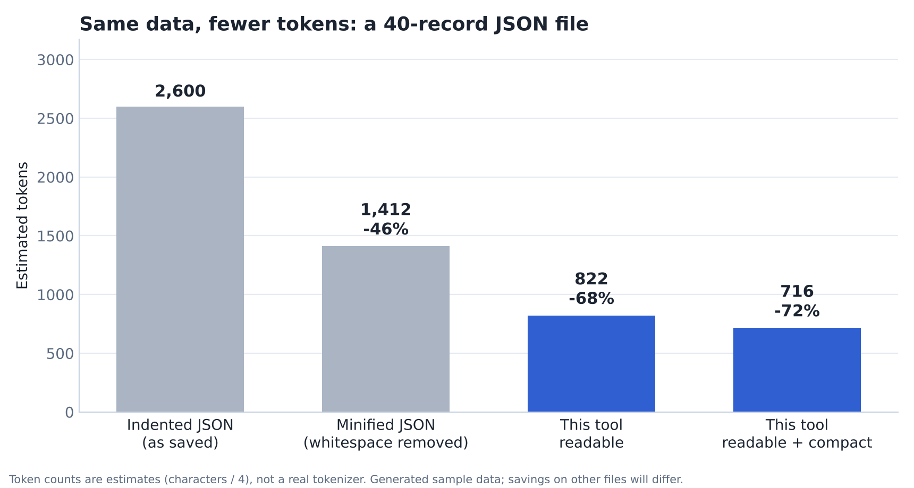

<!-- BANNER -->
<p align="center">
  
</p>

<h1 align="center">AI Document Analyst</h1>
<p align="center"><b>Turn PDFs, Office files, slide pictures and data files into compact Markdown for AI chats.<br>Local, free, no API key.</b></p>

<p align="center">
  
  
  
  
</p>

<p align="center">
  <a href="#4-quick-start">Quick start</a> ·
  <a href="docs/README.md">Documentation</a> ·
  <a href="docs/08_user_guide.md">User guide</a> ·
  <a href="PORTFOLIO.md">Portfolio page</a> ·
  <a href="CHANGELOG.md">Changelog</a> ·
  <a href="https://github.com/Shimu-I/ai-document-analyst">GitHub</a>
</p>

<p align="center">
  
  
</p>
<p align="center"><sub>Home page in the soft light theme and in Dim mode (rendered from the page's HTML and CSS).</sub></p>

## Contents

1. [Overview](#1-overview)
2. [Key features](#2-key-features)
3. [Screenshots](#3-screenshots)
4. [Quick start](#4-quick-start)
5. [Usage](#5-usage)
6. [How it works](#6-how-it-works)
7. [Tech stack](#7-tech-stack)
8. [Results](#8-results)
9. [Project structure](#9-project-structure)
10. [Documentation](#10-documentation)
11. [Limitations](#11-limitations)
12. [Future improvements](#12-future-improvements)
13. [Contributors and license](#13-contributors-and-license)

## 1. Overview

AI Document Analyst reads a file and returns three things: a clean Markdown version of its content, a statement of what kind of document it is, and a short summary.

- **Inputs:** PDF, DOCX, XLSX, PPTX, CSV, images (OCR), JSON, YAML, TOML, XML, HTML, Jupyter notebooks and source code.
- **Interfaces:** a web app, a desktop window, a command line and an HTTP API, all over one code path.
- **Runs offline.** Nothing is uploaded to other services and no paid API is needed.

**Why it exists.** AI chats count and limit tokens. Documents waste many of them: page headers repeated on every PDF page, JSON braces and repeated keys, padded tables, slides sent as pictures when only the text matters. Asking a chatbot to "convert this to Markdown" also spends output tokens re-typing the file and uploads it to a third party.

**What it does about it.** Convert once, locally. The Markdown keeps the text, tables and structure, drops layout noise, and reports everything that could not be converted (pictures, headers, low OCR confidence) as warnings instead of hiding it. Compact mode shrinks the result further, and `--max-tokens N` splits long documents into parts that fit a chat limit.

## 2. Key features

| Area | What it does |
|---|---|
| **Formats** | PDF, Word, Excel, PowerPoint, CSV, images, data files, HTML, notebooks, code. One result type for all. |
| **Slides saved as pictures** | Text inside pictures in PowerPoint, Word and PDF files is read with OCR, keeping bullets and nesting. English and Bengali (`--lang auto`). |
| **Desktop window** | Original slide on the left, its text in the same layout on the right. Click a text line to mark its place on the slide, or click the slide to select the line. Text is editable. |
| **Equations, tables, diagrams** | Word equations become LaTeX; PDF equations and diagrams are saved as images with their text; tables stay tables. |
| **PDF layout recovery** | Headings from font size, two-column reading order, tables, header and footer removal, OCR fallback for scans. |
| **Web app** | Top navigation, landing page, Convert, Dashboard, User guide and an in-app Documentation page with search. Soft light theme and Dim mode. |
| **Model status chip** | The top bar shows whether the open-source AI model used for summaries is running. |
| **Token tools** | Compact mode, split by token budget, token estimate, image-versus-text cost comparison. |
| **Honest summaries** | Extractive by default (cannot invent). An optional AI summary is rejected if it contains numbers missing from the document. |

## 3. Screenshots

| Command line (real output) | Image to Markdown (sample article) |
|---|---|
|  |  |

The Home page renderings above are built from the page's own HTML and CSS. Captures of the running web app and of the desktop window can be added to `docs/assets/` (for example `ui_convert.png`, `desktop_window.png`) and linked here.

## 4. Quick start

```bash
git clone https://github.com/Shimu-I/ai-document-analyst.git
cd ai-document-analyst
sudo apt install -y python3 python3-venv tesseract-ocr     # macOS: brew install python tesseract
python3 -m venv .venv && source .venv/bin/activate
pip install -r requirements.txt
streamlit run app/streamlit_app.py                         # opens http://localhost:8501
```

Optional extras:

| For | Install |
|---|---|
| Bengali text in pictures | `sudo apt install tesseract-ocr-ben` |
| Desktop window | `sudo apt install python3-tk` |
| PowerPoint, Word and old `.doc/.xls/.ppt` files read as slides | `sudo apt install libreoffice-impress libreoffice-writer libreoffice-calc` |
| Docker | `docker compose up --build` |

Full setup, other systems and a check list: [docs/07](docs/07_installation_and_setup.md).

## 5. Usage

```bash
streamlit run app/streamlit_app.py                       # web app, http://localhost:8501
bash scripts/run_desktop.sh                              # desktop window (slides beside their text)
python -m src.cli report.pdf --compact -o markdown/      # one file
python -m src.cli book.pdf --max-tokens 3000             # parts of about 3,000 tokens
python -m src.cli paper.pdf --images -o out/             # keep figures and equations as images
python -m src.cli deck.pptx --pictures-ocr -o out/       # read text inside slide pictures
python -m src.cli scan.png --stdout --lang auto          # OCR to the terminal (English + Bengali)
uvicorn api.main:app                                     # API docs at http://localhost:8000/docs
```

Every flag, the API fields and a token-saving workflow: [docs/08](docs/08_user_guide.md). Problems and fixes: [docs/13](docs/13_troubleshooting.md).

## 6. How it works

<p align="center"></p>

1. The file extension selects a converter. Empty, oversized and unsupported files are rejected with clear codes (400, 413, 415, 422).
2. The converter rebuilds structure: PDF from word geometry, images and slide pictures from OCR word boxes, data files from record shapes.
3. Optional compact mode removes padding and empty values. The document is classified by weighted keyword cues and summarised.
4. The output is returned as `.md` (or numbered parts and a `.zip`) with type, summary, outline, token estimate and warnings.

`src/service.py` serves the web app, the CLI and the API identically; `src/slides.py` feeds the desktop window. Details with diagrams: [docs/04](docs/04_system_architecture.md) and [docs/05](docs/05_internal_workflow.md). Rebuilding it step by step: [build from scratch](docs/deep_dive/build_from_scratch.md).

## 7. Tech stack

| Area | Tools |
|---|---|
| Language | Python 3.11+ |
| Parsing | pdfplumber, pypdfium2, python-docx, openpyxl, python-pptx, BeautifulSoup, PyYAML |
| OCR | Tesseract through pytesseract, Pillow (English and Bengali) |
| Interfaces | Streamlit (web), Tkinter (desktop), argparse (CLI), FastAPI (API) |
| Optional AI summary | Ollama or any OpenAI-compatible endpoint, Anthropic API |
| Quality | unittest/pytest (131 tests), a 49-case corner-case script, a fidelity script |
| Packaging | Docker, docker-compose |

## 8. Results

| Measure | Result | Caveat |
|---|---|---|
| Reading order, 3 sample PDFs | 100% (markitdown: 52% to 93%) | Small, synthetic, tuned-on samples |
| Headings recovered, 3 sample PDFs | 22 of 22 (markitdown: 0 of 22) | markitdown does not infer headings from PDFs |
| Scanned sample PDF, word recall | 99.1% | Clean synthetic scan |
| 40-record JSON, estimated tokens | 2,600 indented, 1,416 minified, 716 readable + compact (-49% vs minified) | One generated file; estimate, not a real tokenizer |
| Tests | 131 unit tests, 49 corner cases | The web app, API server, Docker and desktop window were not run by the build process |

<p align="center"> </p>

Savings against a chatbot's own file reader were **not** measured. Method and caveats: [docs/10](docs/10_testing_and_evaluation.md).

## 9. Project structure

```text
ai-document-analyst/
├── src/
│   ├── convert/          pdf, office, image, structured, compact, picture_ocr, assets, omml
│   ├── analyze/          classify.py, summarize.py
│   ├── llm/              optional AI summary clients
│   ├── service.py        shared entry point (CLI, API, web app)
│   ├── slides.py         slide-by-slide reading with line boxes
│   ├── desktop_model.py  state and geometry of the desktop window
│   ├── model_status.py   open-source model chip
│   ├── history.py        SQLite record of conversions (dashboard)
│   └── cli.py            command line
├── app/
│   ├── streamlit_app.py  web entry and navigation
│   ├── ui.py, landing.py shared look and landing page
│   ├── views/            home, convert, dashboard, guide, docs
│   └── desktop.py        Tkinter window
├── api/main.py           FastAPI
├── .streamlit/           theme and toolbar settings
├── scripts/              samples, fidelity, corner cases, diagrams, run_desktop.sh
├── tests/                131 tests
├── data/samples/         synthetic documents and expected content
├── docs/                 15 numbered documents, deep_dive/, assets/
├── Dockerfile, docker-compose.yml, requirements.txt, packages.txt
├── CHANGELOG.md          what each update version added
└── PORTFOLIO.md          portfolio card and details page
```

## 10. Documentation

| # | Document | # | Document |
|---|---|---|---|
| 01 | [Project overview](docs/01_project_overview.md) | 09 | [Reproducibility guide](docs/09_reproducibility_guide.md) |
| 02 | [Features and functionalities](docs/02_features_and_functionalities.md) | 10 | [Testing and evaluation](docs/10_testing_and_evaluation.md) |
| 03 | [Technology stack](docs/03_technology_stack.md) | 11 | [Limitations and known issues](docs/11_limitations_and_known_issues.md) |
| 04 | [System architecture](docs/04_system_architecture.md) | 12 | [Future improvements](docs/12_future_improvements.md) |
| 05 | [Internal workflow](docs/05_internal_workflow.md) | 13 | [Troubleshooting](docs/13_troubleshooting.md) |
| 06 | [Implementation details](docs/06_implementation_details.md) | 14 | [References and acknowledgements](docs/14_references_and_acknowledgements.md) |
| 07 | [Installation and setup](docs/07_installation_and_setup.md) | 15 | [Contributors and license](docs/15_contributors_and_license.md) |
| 08 | [User guide](docs/08_user_guide.md) | | Older long chapters: [deep_dive/](docs/deep_dive/) |

The same documents are readable inside the web app on the **Docs** page, with search and diagrams.

## 11. Limitations

- Pictures, charts and handwriting are not described; they can be saved as image files, but only text is read. PDF equations are images, not LaTeX.
- OCR can misread names, numbers and small print. Bengali was checked only on generated text in one font.
- Borderless PDF tables become plain text. Word headers, footers, footnotes and text boxes are not included (a warning is shown).
- The web app and the desktop window were written and tested against stand-ins for Streamlit and Tkinter; a first real run can show small layout problems.
- Evaluation uses small synthetic samples; there is no real-document corpus and no measured savings against chatbots.
- No login or rate limit on the web app or the API: not for public exposure as it is. Tested on Linux only.

Full list: [docs/11](docs/11_limitations_and_known_issues.md).

## 12. Future improvements

- Captures from the running apps and a free hosted demo ([deployment notes](docs/deep_dive/deployment_free.md)).
- A real-document evaluation set and a real tokenizer option.
- Drag and drop for the desktop window, and a packaged program that runs without Python.
- Borderless table detection, Word headers and footnotes, right-to-left language tests, an API password.

Full list: [docs/12](docs/12_future_improvements.md).

## 13. Contributors and license

| Contributor | Role |
|---|---|
| **Shimu-I** ([@Shimu-I](https://github.com/Shimu-I)) | Project owner: idea, direction, review, testing on a real machine, publishing |
| **Claude** (AI assistant by Anthropic) | Development partner: wrote and tested code and documents in the build sessions, under the owner's direction |

Repository: <https://github.com/Shimu-I/ai-document-analyst>. Issues and pull requests are welcome; adding a failing case to `scripts/corner_cases.py` first makes a good bug report.

License: MIT, see [LICENSE](LICENSE).
