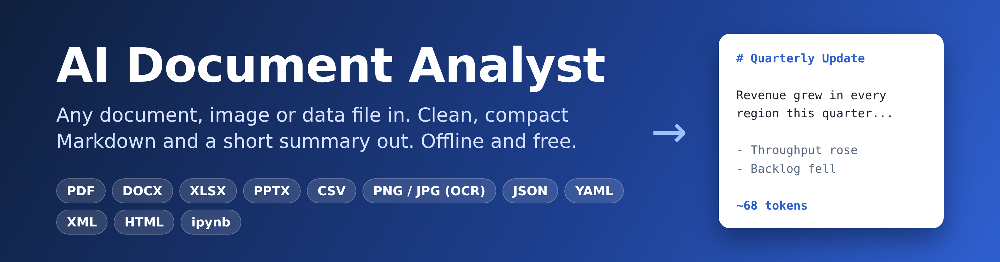
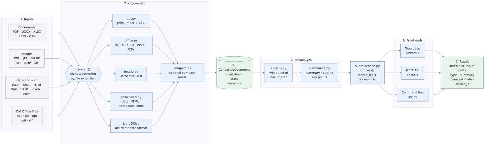
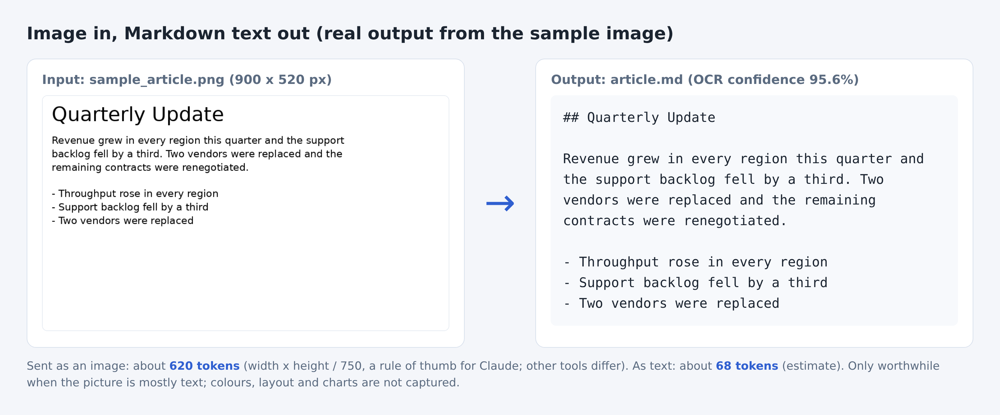
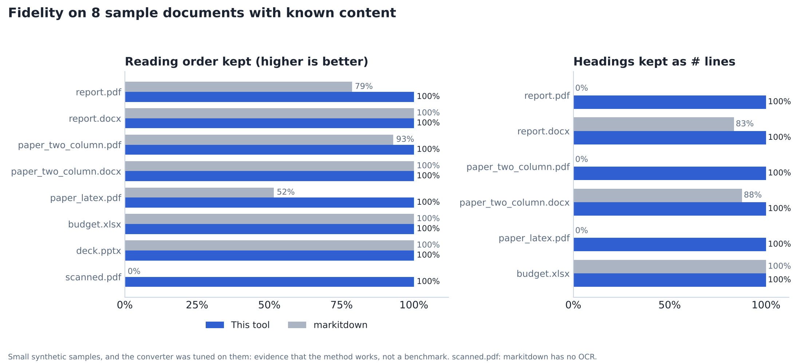

<!-- 0. BANNER -->
<p align="center">
  
</p>

<h1 align="center">AI Document Analyst</h1>
<p align="center"><b>Turn PDFs, Office files, images and data files into compact Markdown for AI chats. Local, free, no API key.</b></p>

<p align="center">
  
  
  
  
</p>

<p align="center">
  <a href="docs/00_index.md">Documentation</a> ·
  <a href="docs/06_user_manual.md">User manual</a> ·
  <a href="PORTFOLIO.md">Portfolio page</a> ·
  <!-- Live Demo: none yet. Add the link here after deploying (docs/09_deployment_free.md) -->
  <a href="https://github.com/<GITHUB-USERNAME>/ai-document-analyst/issues">Report a bug</a>
</p>

## 1. Overview

AI Document Analyst reads a file and returns three things: a clean Markdown version of its content, a statement of what kind of document it is, and a short summary.
Supported inputs are PDF, DOCX, XLSX, PPTX, CSV, images (OCR), JSON, YAML, TOML, XML, HTML, Jupyter notebooks and source code. It runs offline from a web page, a command line or an HTTP API.

## 2. Problem

AI chats count and limit tokens. Documents waste many of them: page headers repeated on every PDF page, JSON braces and repeated keys, padded tables, screenshots sent as images when only the text matters.
Asking a chatbot to "convert this to Markdown" also spends output tokens re-typing the whole file, and uploads it to a third party.

## 3. Solution

Convert once, locally and for free. The Markdown keeps the document's text, tables and structure, drops layout noise, and reports everything that could not be converted (pictures, headers, low OCR confidence) as warnings instead of hiding it.
Compact mode shrinks it further, and `--max-tokens N` splits long documents into parts that fit a chat limit.

## 4. Key features

- **Many formats, one result type:** PDF, Word, Excel, PowerPoint, CSV, images, data files, HTML, notebooks, code.
- **PDF layout recovery:** headings from font size, two-column reading order, tables, header and footer removal, OCR fallback for scans.
- **Image OCR:** preparation (rotation, transparency, dark mode), line and list rebuilding, confidence and doubtful words.
- **Token tools:** compact mode, split by token budget, token estimate, image-versus-text cost comparison.
- **Honest summaries:** extractive by default (cannot invent); an optional AI summary is rejected if it contains numbers missing from the document.
- **Three interfaces, one code path:** Streamlit page, CLI, FastAPI.

## 5. Architecture

<p align="center"></p>

Converters (`src/convert/`) return a shared `ConvertedDocument`. Analysis (`src/analyze/`) classifies and summarises it. `src/service.py` serves the CLI, the API and the web page identically. Details: [docs/04](docs/04_concepts_and_architecture.md).

## 6. Tech stack

| Area | Tools |
|---|---|
| Language | Python 3.11+ |
| Parsing | pdfplumber, python-docx, openpyxl, python-pptx, BeautifulSoup, PyYAML |
| OCR | Tesseract through pytesseract, Pillow |
| Interfaces | Streamlit, FastAPI, argparse |
| Optional AI summary | Ollama or any OpenAI-compatible endpoint, Anthropic API |
| Quality | unittest/pytest (89 tests), a 49-case corner-case script, a fidelity script |
| Packaging | Docker, docker-compose |

## 7. How it works

1. The file extension selects a converter; empty, oversized and unsupported files are rejected with clear codes (400, 413, 415, 422).
2. The converter rebuilds structure: PDF from word geometry, images from OCR word boxes, data files from record shapes.
3. Optional compact mode removes padding and empty values; the document is classified by weighted keyword cues and summarised.
4. Output is returned as `.md` (or numbered parts and a `.zip`) with type, summary, outline, token estimate and warnings.

Walkthroughs with diagrams: [docs/04](docs/04_concepts_and_architecture.md). Rebuilding it step by step: [docs/05](docs/05_build_from_scratch.md).

## 8. Screenshots

| Command line (real output) | Image to Markdown (sample article) |
|---|---|
|  |  |

<!-- TODO: add real screenshots of the Streamlit page after the first local run: docs/assets/ui_home.png, docs/assets/ui_result.png -->

## 9. Installation

```bash
git clone https://github.com/<GITHUB-USERNAME>/ai-document-analyst.git
cd ai-document-analyst
sudo apt install -y python3 python3-venv tesseract-ocr     # macOS: brew install python tesseract
python3 -m venv .venv && source .venv/bin/activate
pip install -r requirements.txt
```

Optional: LibreOffice for old `.doc/.xls/.ppt` (`sudo apt install libreoffice-writer libreoffice-calc libreoffice-impress`). Docker: `docker compose up --build`.

## 10. Usage

```bash
streamlit run app/streamlit_app.py                       # web page, http://localhost:8501
python -m src.cli report.pdf --compact -o markdown/      # one file
python -m src.cli book.pdf --max-tokens 3000             # parts of about 3,000 tokens
python -m src.cli scan.png --stdout --lang eng+ben       # OCR to the terminal
uvicorn api.main:app                                     # API docs at http://localhost:8000/docs
```

Every flag, the API fields and a token-saving workflow: [docs/06_user_manual.md](docs/06_user_manual.md). Awkward inputs and fixes: [docs/10](docs/10_corner_cases_and_troubleshooting.md).

## 11. Results

| Measure | Result | Caveat |
|---|---|---|
| Reading order, 3 sample PDFs | 100% (markitdown: 52% to 93%) | Small, synthetic, tuned-on samples |
| Headings recovered, 3 sample PDFs | 22 of 22 (markitdown: 0 of 22) | markitdown does not infer headings from PDFs |
| Scanned sample PDF, word recall | 99.1% | Clean synthetic scan |
| 40-record JSON, estimated tokens | 2,600 indented, 1,412 minified, 716 readable + compact (-49% vs minified) | One generated file; estimate, not a real tokenizer |
| Tests | 89 unit tests, 49 corner cases | Streamlit, API server and Docker not run in the build environment |

<p align="center"> </p>

Savings against a chatbot's own file reader were **not** measured. Method and caveats: [docs/03](docs/03_evaluation.md).

## 12. Project structure

```text
ai-document-analyst/
├── src/convert/      pdf, office, image, structured, compact, dispatch
├── src/analyze/      classify.py, summarize.py
├── src/llm/          optional AI summary clients
├── src/service.py    shared entry point (CLI, API, web page)
├── src/cli.py        command line
├── api/main.py       FastAPI
├── app/streamlit_app.py
├── scripts/          samples, fidelity, corner cases, figures
├── tests/            89 tests
├── data/samples/     synthetic documents and expected content
├── docs/             chapters 00-11 and docs/assets (figures)
├── Dockerfile, docker-compose.yml, requirements.txt, packages.txt
└── PORTFOLIO.md      portfolio card and details page
```

## 13. Limitations

- Pictures, charts and handwriting are not described; only text is read.
- OCR can misread names, numbers and small print; borderless PDF tables become plain text; equations become text fragments.
- Word headers, footers, footnotes and text boxes are not included (warned).
- Evaluation uses small synthetic samples; no real-document corpus and no measured savings against chatbots.
- No login or rate limit on the page or the API: not for public exposure as is.
- Tested on Linux only.

## 14. Future improvements

- Real UI screenshots and a free hosted demo (see [docs/09](docs/09_deployment_free.md)).
- A real-document evaluation set and a real tokenizer option.
- Borderless table detection, DOCX headers and footnotes, right-to-left language tests.
- Password protection for the API.

## 15. Contributors

Built by **<AUTHOR NAME>** ([@<GITHUB-USERNAME>](https://github.com/<GITHUB-USERNAME>)). Issues and pull requests are welcome; adding a failing case to `scripts/corner_cases.py` first makes a good bug report.

## 16. License

MIT, see [LICENSE](LICENSE).
