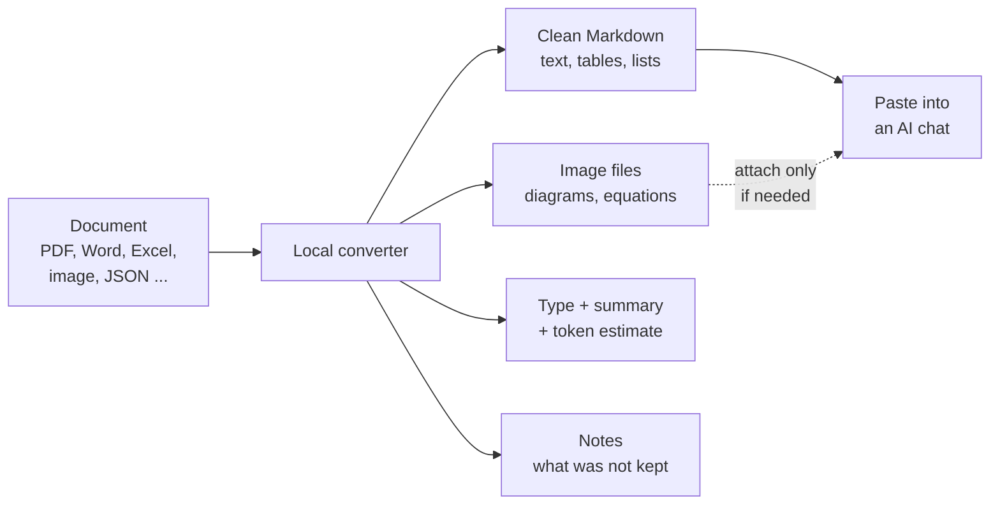
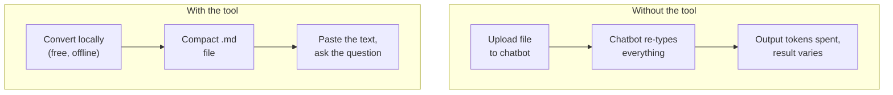

# 01 - Project Overview

## Summary

**AI Document Analyst** is a free tool that runs on a local computer. It reads a file (PDF, Word, Excel, PowerPoint, image, data file, web page, code) and gives back:

1. a clean **Markdown (`.md`) copy** of the content,
2. a label that says **what kind of document** it is,
3. a short **summary**, an outline and a token estimate.

The Markdown is smaller than the original file. It can be pasted into any AI chat instead of the file, so fewer tokens are used.

## Motivation

AI chat tools count text in **tokens** (small pieces of words, about 4 English letters each). Free plans and context windows are limited, so every wasted token matters.

The idea started from a simple habit: uploading a file to a chatbot and asking it to "turn this into text". That has three costs:

- The chatbot spends many **output tokens** re-typing the whole document.
- The result can **change from run to run** (missing rows, reordered text).
- The file is **uploaded to a third party** only to get its text back.

A local converter does the same job once, for free, in the same way every time.

## Problem statement

> Documents carry far more tokens than their meaning needs, and converting them with a chatbot is slow, costly, not repeatable and not private.

Where the waste comes from:

| Source of waste | Example |
|---|---|
| Layout noise | The same header and page number printed on all 49 pages of a PDF |
| Structure symbols | JSON braces, quotes and repeated key names for every record |
| Padding | Table columns padded with spaces, many blank lines |
| Non-text content | An image sent as expensive input when only its text matters |
| Re-typing | A chatbot asked to copy a whole document into Markdown |

## Proposed solution

Convert once, locally. Keep the information, drop the noise, and report honestly what could not be kept.

## Before and after

## Objectives

| # | Objective | Status |
|---|---|---|
| 1 | Convert common document types to Markdown without losing text or reading order | Done for the 8 sample files; real documents vary |
| 2 | Work fully offline and cost nothing | Done (AI summary is optional) |
| 3 | Keep tables, equations and diagrams | Tables as tables; Word equations as LaTeX; PDF equations and diagrams as images |
| 4 | Say what the document is and summarise it without inventing facts | Done (rule-based type, extractive summary) |
| 5 | Reduce tokens: compact mode, split by token budget | Done |
| 6 | Offer three ways to use it: web page, command line, API | Done (web page and API were not run in the build environment) |
| 7 | Keep a history of conversions | Done (dashboard) |
| 8 | Be honest about limits | Every loss becomes a warning; limits are listed in [11](11_limitations_and_known_issues.md) |

## Who it is for

- Students and analysts who paste papers, reports and spreadsheets into AI chats.
- Developers who want a small, readable example of a document-processing pipeline.
- Anyone who needs plain text from files without sending them to a cloud service.

## Scope

**In scope:** reading files, producing Markdown and images, classification, summary, token tools, web page, command line, API, history dashboard.

**Out of scope:** editing documents, describing the meaning of pictures, handwriting recognition, a login system, a cloud service, a mobile app.

## How success is judged

- No words lost and correct reading order on the sample files ([10](10_testing_and_evaluation.md)).
- Every known loss is reported as a note, never silent.
- All tests pass (131 tests, 1 skipped) and 49 corner cases behave as documented.
- A new person can install and run the tool from the instructions alone ([07](07_installation_and_setup.md), [09](09_reproducibility_guide.md)).

## Honesty note

Savings compared with a chatbot's own file reader were **not measured**. Numbers in this documentation come from small generated sample files and from scripts in the repository, so they show that the pipeline works, not how it performs on every real document.

---
Next: [02 Features and Functionalities](02_features_and_functionalities.md)
