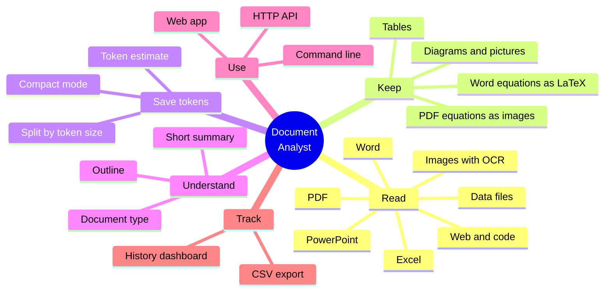
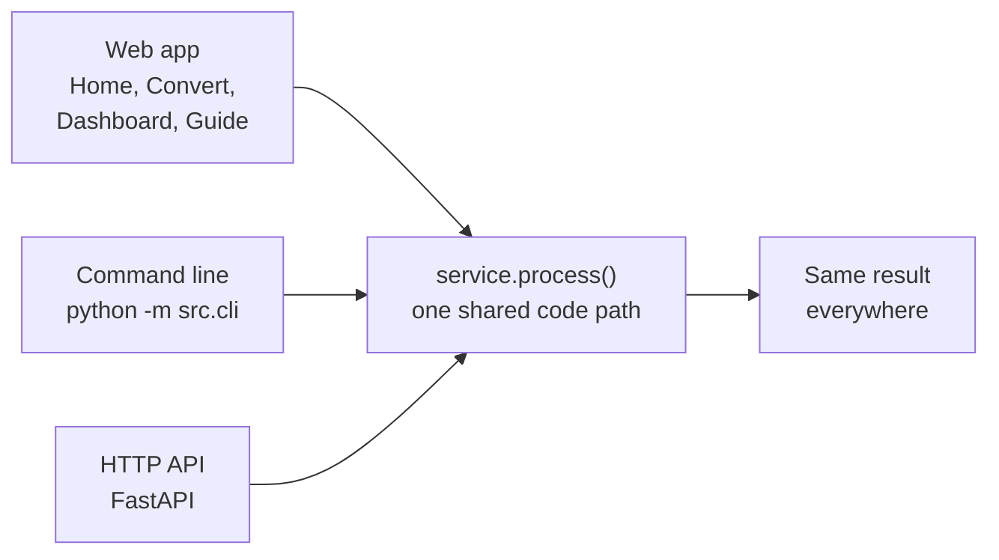

# 02 - Features and Functionalities

## Feature map

## Complete feature list

| Area | Feature | Notes |
|---|---|---|
| Input | PDF (text and scanned) | Layout rebuilt from word positions; scans read with OCR |
| Input | Word `.docx` | Headings, lists, tables, links, bold, italic, equations, pictures |
| Input | Excel `.xlsx` `.xlsm` | One section per visible sheet; tables per block of rows |
| Input | PowerPoint `.pptx` | One section per slide; tables, chart data, notes, pictures |
| Input | Text inside pictures (image-based slides) | OCR on pictures in PPTX, DOCX and PDF; text added as quoted lines under the picture |
| Input | CSV, TSV | Delimiter and text encoding detected |
| Input | Images: PNG, JPG, WEBP, TIFF, BMP, GIF | OCR with preparation and layout rebuilding |
| Input | JSON, JSONL, YAML, TOML, XML | Lists of similar records become one table |
| Input | Jupyter notebooks, HTML, source code | Cells and outputs, main page content, fenced code |
| Input | Old Office files (`.doc .xls .ppt .odt .ods .odp .rtf`) | Needs LibreOffice installed |
| Input | Google shortcut files (`.gsheet` and similar) | Cannot be read; the tool explains how to export |
| Output | Markdown (`.md`) | One file, or numbered parts |
| Output | Image files in `assets/` | Figures, diagrams, equations, pictures |
| Output | `.zip` | Several files, split parts, or `.md` plus images |
| Analysis | Document type | Research paper, report, contract, resume, invoice, meeting notes and more |
| Analysis | Summary and key points | Extractive by default; optional AI summary with a safety check |
| Analysis | Outline | Headings up to level 3 |
| Tokens | Token estimate | About 4 characters per token (English); 1.5 for other scripts |
| Tokens | Compact mode | Removes padding, comments, empty values |
| Tokens | Split by token budget | Breaks before headings; repeats table headers |
| Tokens | Image cost hint | Shows the estimated cost of sending the image itself |
| Quality | Notes (warnings) | Lists everything that was not converted faithfully |
| Quality | OCR confidence | Mean confidence and doubtful words |
| Interface | Desktop window | Tkinter program: filmstrip of slides, original slide, editable text in the same layout, linked both ways (click a line to mark its place on the slide, click the slide to select the line) |
| Input | Bengali and English | OCR language `auto` reads English, plus Bengali when its language pack is installed |
| Interface | Documentation page | All documents in the app, with section list, contents, search and previous / next buttons |
| Interface | Model chip | Shows whether the open-source AI model for summaries is Active, Not running, Not installed or off |
| Interface | Soft light and Dim themes | Switch in the top bar |
| Tracking | History dashboard | Date, type, size, time, counts; filters; CSV export |

## Supported formats and what comes out

| Input | Output |
|---|---|
| PDF | Headings (`#`), paragraphs, lists, tables, code blocks, two-column text in reading order; headers and footers removed; figures and display equations as images |
| DOCX | Markdown with bold, italic, links, nested lists, tables; `$...$` LaTeX for equations; pictures as images |
| XLSX | `## Sheet name` plus a table per block |
| PPTX | `## Slide N: title`, bullets, tables, chart data as tables, notes as quotes, pictures as images |
| Image | Plain text with lines, lists, headings; confidence in the stats |
| JSON-like | Table for a list of similar records; `key: value` lines otherwise |
| HTML | Main content only; menus, scripts, link addresses removed |
| Code | A fenced block with the language name |

## Interfaces

| Interface | Start | Best for |
|---|---|---|
| Web app | `streamlit run app/streamlit_app.py` | Single files, preview, download, history |
| Command line | `python -m src.cli file.pdf` | Batches, scripts |
| HTTP API | `uvicorn api.main:app` | Other programs |

## Capabilities in short

- **Offline and free.** No account, key or internet needed for conversion.
- **Honest.** Dropped content is reported as a note.
- **Safe summaries.** The default summary only picks sentences that already exist.
- **Repeatable.** The same file and options give the same output.
- **Private.** Only file names and counts go into the history, never document text.

## Not included

Editing files, describing pictures, handwriting, user accounts, cloud hosting by default. See [11 Limitations](11_limitations_and_known_issues.md).

---
Previous: [01 Overview](01_project_overview.md) · Next: [03 Technology Stack](03_technology_stack.md)
