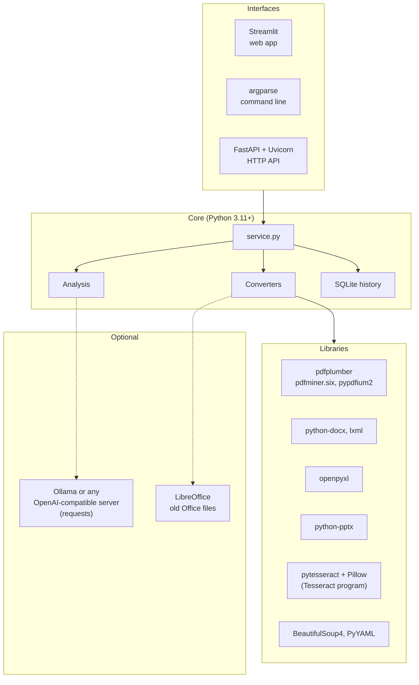

# 03 - Technology Stack

## The stack at a glance

## Languages

| Language | Used for | Why |
|---|---|---|
| Python 3.11+ | Everything | Best library support for documents and OCR; readable for learning |
| Markdown | Output format | Plain text, compact, understood by every AI tool |
| Mermaid | Diagrams in the documentation | Text diagrams that render on GitHub and stay in version control |
| Bash | Install and update scripts | Available on Ubuntu without extra tools |

## Libraries and tools

| Tool | Role | Why it was chosen |
|---|---|---|
| **pdfplumber** | PDF words with position, font, size; lines; tables; page images | Exposes the geometry needed to rebuild reading order. Built on pdfminer.six; renders pages through pypdfium2 |
| **python-docx** | Read Word files | Standard library for `.docx`; access to the XML for equations and pictures |
| **lxml** | XML tree for Word equations | Comes with python-docx; fast and exact |
| **openpyxl** | Read Excel | Reads values, merged cells, hidden sheets; formulas with or without cached values |
| **python-pptx** | Read PowerPoint | Slides, shapes, tables, charts, notes, pictures |
| **Tesseract + pytesseract** | OCR | Free, offline, many languages. pytesseract is the Python bridge |
| **Pillow** | Image preparation and cropping | Rotation, transparency, contrast, resizing, PNG output |
| **BeautifulSoup4** | HTML | Forgiving parser to keep main content |
| **PyYAML** | YAML | Safe loading of YAML and multi-document files |
| **tomllib** (standard library) | TOML | Built into Python 3.11 |
| **requests** | Optional AI summary | Talks to Ollama or any OpenAI-compatible server |
| **Tkinter** | Desktop window | Ships with Python, no extra install on Windows and macOS, no browser; enough for a three-pane viewer |
| **Streamlit** (1.36+) | Web app | Fast to build, pure Python, multi-page support with `st.navigation` |
| **FastAPI + Uvicorn** | HTTP API | Typed, automatic `/docs` page |
| **python-multipart** | File upload in FastAPI | Required by FastAPI for forms |
| **SQLite** (standard library) | History | One local file, no server |
| **pytest / unittest** | Tests | 131 tests; no special setup |
| **reportlab, pypdf** | Build test PDFs | Make rotated, encrypted and multi-page test files |
| **matplotlib** | Measured charts | Only for `scripts/make_figures.py` |
| **Mermaid CLI (mmdc)** | Render diagrams to PNG | Only for the figures in `docs/assets` |
| **pdflatex** | Make a real equation PDF | Only for one test sample script |
| **Docker, docker-compose** | Optional packaging | Same environment on any computer |
| **markitdown** | Comparison baseline | Not a dependency; used only in the evaluation script |

## Design choices in the stack

| Choice | Reason |
|---|---|
| Local libraries, no cloud API | Free, private, repeatable |
| Rules and geometry instead of a trained model | Explainable, light, no downloads; every decision can be inspected |
| One shared service layer | The three interfaces cannot drift apart |
| SQLite for history | Nothing to install or run; only metadata is stored |
| Streamlit for the UI | Small code, good enough for a tool; limits: no login, one process |
| Optional LLM, never required | The core promise is "works without paying" |

## Alternatives that were not used

| Alternative | Why not used |
|---|---|
| PyMuPDF | Fast, but its license (AGPL) is stricter for a public project |
| Cloud OCR or vision APIs | Cost money and upload documents |
| A trained layout model (for example LayoutLM) | Heavy downloads, needs GPU for speed, harder to explain |
| Flask or Django for the UI | More code for the same result |
| A real tokenizer library | Model-specific and often needs downloads; an estimate is enough for planning |

---
Previous: [02 Features](02_features_and_functionalities.md) · Next: [04 System Architecture](04_system_architecture.md)
