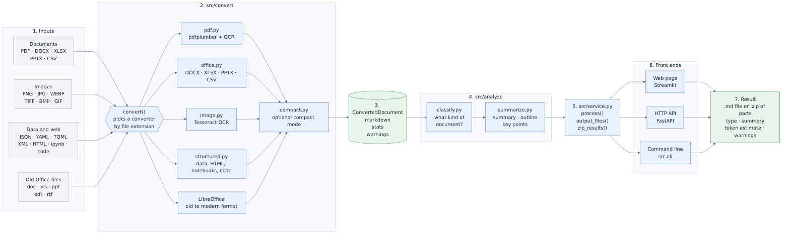
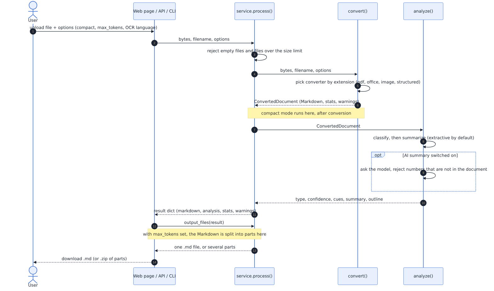
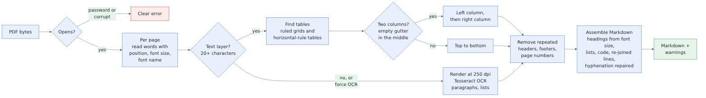
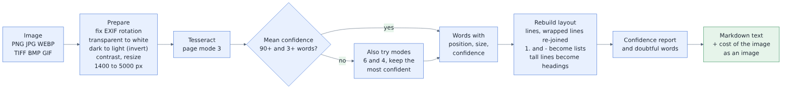
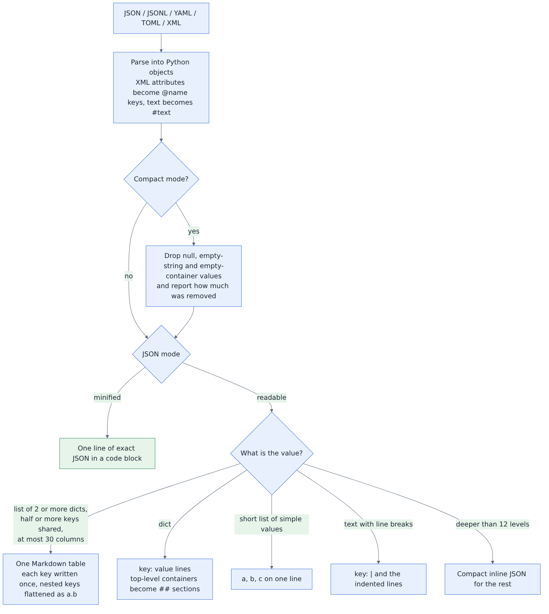
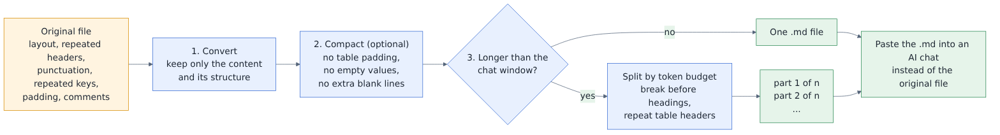
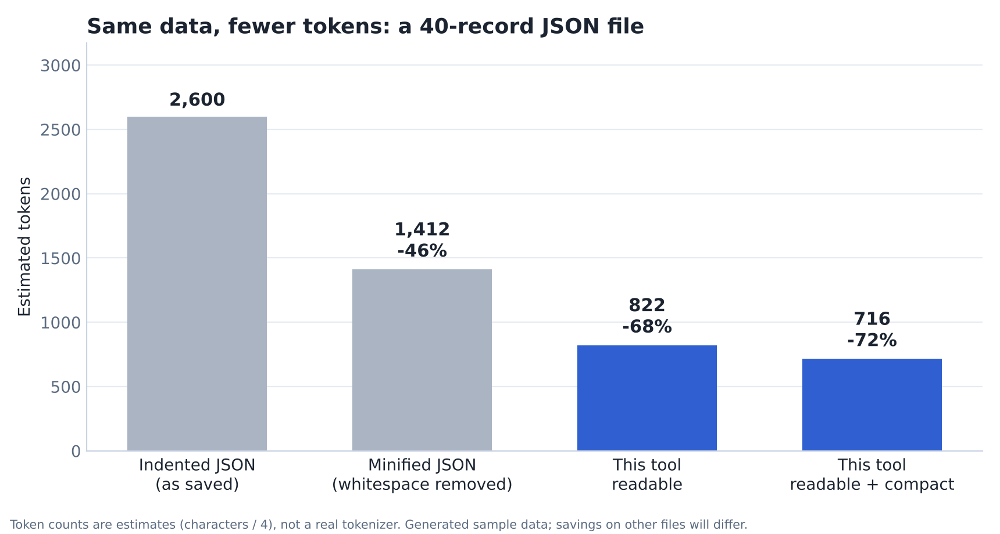
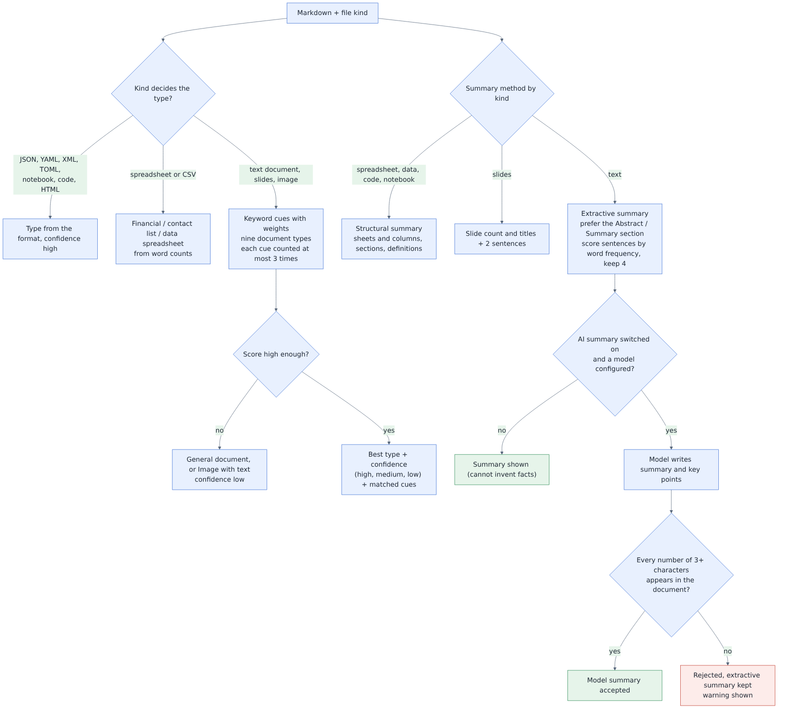

# 04 - Concepts and architecture

This chapter explains what the project is, which problem it addresses, and how the pieces fit together.
Later chapters build on it: [05](05_build_from_scratch.md) rebuilds the project step by step,
[06](06_user_manual.md) explains day-to-day use.

## 1. What this project is

**AI Document Analyst** is a local tool that reads a file and produces three things:

1. **A clean Markdown (`.md`) version of the content**: headings, paragraphs, lists, tables, code, slides, sheets.
2. **A statement of what the file is**: research paper, business report, spreadsheet, presentation, JSON data, and so on.
3. **A short summary** with an outline and a token estimate.

Supported inputs:

| Family | Formats | Method |
|---|---|---|
| Office documents | PDF, DOCX, XLSX/XLSM, PPTX, CSV/TSV, TXT/MD | Parsers: pdfplumber, python-docx, openpyxl, python-pptx |
| Scans and pictures | PNG, JPG, WEBP, TIFF, BMP, GIF; PDF pages without a text layer | Tesseract OCR |
| Data files | JSON, JSONL, YAML, TOML, XML, Jupyter notebooks | Compact rendering (tables and `key: value` lines) |
| Web and code | HTML, source code files | Main-content extraction, fenced code blocks |
| Old Office files | DOC, XLS, PPT, ODT, ODS, ODP, RTF | LibreOffice converts to a modern format first |
| Google files | `.gsheet`, `.gdoc`, `.gslides`, `.gdraw`, `.gform` | Not readable: they are shortcuts. The tool explains how to export |

Everything runs locally. No account, API key or internet connection is needed for conversion.

## 2. The problem

Large language models (LLMs) and chatbots charge for, or limit, the amount of text processed. That amount is
measured in **tokens** (word fragments; roughly 4 characters of English each).
Documents hand over far more tokens than their meaning requires:

| Source of waste | Example |
|---|---|
| Layout noise | Running headers and footers repeated on every PDF page; page numbers |
| Structural punctuation | JSON braces, quotes and commas; the same keys repeated for every record |
| Padding | Aligned Markdown tables, blank lines, comments |
| Non-text content | Images processed as expensive input when only the text matters |
| Re-typing | Asking a chatbot to "convert this to Markdown" spends *output* tokens on the whole document |

Converting once, locally and for free, produces a compact text version that can be pasted into any chat instead of the
original file, or kept as a plain-text archive.

> **Honesty note.** The `.md` contains the same information as the document's text. Savings come from removing what
> is *not* text and from not paying a chatbot to do the conversion. No percentage of savings against any chatbot's own
> file reader was measured. Token counts shown by the tool are estimates (see section 8).

## 3. Design principles

| Principle | What it means in the code |
|---|---|
| **Offline and free first** | No paid service is required. An AI summary is optional, through local Ollama or any OpenAI-compatible endpoint |
| **Faithful over pretty** | Goal: no text lost, correct reading order. Whatever is dropped (pictures, headers) is **reported as a warning** instead of vanishing silently |
| **Summaries cannot invent** | The default summary only *selects* existing sentences. An AI summary is rejected if it contains a number that is absent from the document |
| **One code path** | `src/service.py` serves the web page, the API and the command line, so all three behave identically |
| **Explainable rules** | Document-type detection is keyword scoring that returns the cues it matched. No hidden model |
| **Honest numbers** | Every figure in the docs is reproducible with a script in `scripts/`, with its caveats stated |

## 4. Architecture



*Figure 1. Files flow left to right: inputs, converters, the shared `ConvertedDocument`, analysis, the service layer, the three front ends.*

### The three layers

1. **Conversion (`src/convert/`)** turns bytes plus a file name into a `ConvertedDocument`. One module per format family.
   `convert()` in `__init__.py` selects the converter from the file extension.
2. **Analysis (`src/analyze/`)** reads the Markdown and decides the document type and the summary.
3. **Delivery (`src/service.py`, `src/cli.py`, `api/main.py`, `app/streamlit_app.py`)** validates requests, calls the
   layers above, and packages results as `.md` files, `.zip` archives or JSON.

Dependencies point downward only: analysis imports conversion types; conversion knows nothing about analysis; the
front ends know nothing about parsers. Replacing Streamlit with another UI would touch one file.

### Module map

| Path | Lines | Responsibility |
|---|---:|---|
| `src/convert/base.py` | 111 | `ConvertedDocument`, `ConversionError`, `estimate_tokens`, Markdown table helpers, `tidy` |
| `src/convert/__init__.py` | 127 | `convert()` dispatch, accepted extensions, LibreOffice bridge for old formats |
| `src/convert/pdf.py` | 649 | PDF layout analysis: rows, columns, tables, headings, lists, header/footer removal, OCR fallback |
| `src/convert/office.py` | 396 | DOCX, XLSX, PPTX, CSV converters and text decoding |
| `src/convert/image.py` | 228 | Image preparation, Tesseract calls, layout rebuilding, confidence |
| `src/convert/structured.py` | 422 | JSON/YAML/TOML/XML rendering, notebooks, HTML, code, Google pointer files |
| `src/convert/compact.py` | 140 | Compact mode and splitting by token budget |
| `src/analyze/classify.py` | 108 | Document-type scoring |
| `src/analyze/summarize.py` | 286 | Extractive summary, outline, optional AI summary with number checking |
| `src/llm/client.py`, `cost.py` | 143, 38 | Optional AI clients (Anthropic, OpenAI-compatible/Ollama) and cost estimates |
| `src/service.py` | 110 | `process()`, `output_files()`, `zip_results()`, `health()`, error codes |
| `src/cli.py` | 112 | Command line |
| `api/main.py` | 80 | FastAPI endpoints |
| `app/streamlit_app.py` | 127 | Web page |

### The shared data object

Every converter returns the same dataclass, which is why the rest of the system is format-agnostic:

| Field | Meaning |
|---|---|
| `markdown` | The result text |
| `kind` | `pdf`, `docx`, `xlsx`, `pptx`, `csv`, `image`, `text`, `json`, `yaml`, `toml`, `xml`, `notebook`, `html`, `code` |
| `title`, `pages`, `sheets`, `tables` | Metadata found while converting |
| `images_omitted`, `ocr_pages`, `headers_footers_removed` | What was dropped or how the text was obtained |
| `warnings` | Human-readable list of everything that did not convert faithfully |
| `ocr_confidence`, `image_tokens_est` | Image-specific: mean OCR confidence; cost of sending the image itself |
| `source_chars`, `compact_saved_chars` | Size of the original text and characters removed by compact mode |
| `words`, `est_tokens`, `source_tokens` | Properties computed from the fields above |

## 5. One request, step by step



*Figure 2. What happens between an upload and a download.*

Key points: size and emptiness checks happen first; compact mode runs inside `convert()`; splitting by token budget
happens late, in `output_files()`, because it only matters when files are handed over.

**Error mapping** (`service.process`): empty file -> 400; file above `MAX_UPLOAD_MB` (default 50) -> 413; unsupported
extension -> 415; corrupt, encrypted or invalid file -> 422 with a specific message.

## 6. How each converter thinks

### PDF: rebuilding structure from positions

A PDF stores *where each glyph is drawn*, not paragraphs. The converter reconstructs structure from geometry
([details in chapter 05, phase 4](05_build_from_scratch.md#phase-4--pdf-the-hardest-converter)):



*Figure 3. PDF pipeline.*

- **Headings** come from font size (about 15% larger than body text or more) or short all-bold lines.
- **Two columns** are detected from an empty vertical strip in the middle of the page, then read left column first.
- **Headers and footers** are lines in the top or bottom 8% of the page whose text (digits ignored) repeats on at least
  half of the pages, in a document of three or more pages; bare page numbers are removed in any document of two or more pages.
- **Scanned pages** (fewer than 20 characters of text) are rendered at 250 dpi and sent to Tesseract.

### Images: OCR with preparation and layout rebuilding



*Figure 4. Image pipeline.*

OCR engines read pixels, so preparation matters: a transparent PNG becomes a black square without flattening onto white;
dark-mode screenshots need inversion; small images need enlarging. Tesseract returns words with positions, and the
converter regroups them into lines, paragraphs, lists and headings. The mean confidence and the doubtful words are
reported so that names and numbers can be checked against the picture.

### Data files: stop paying for punctuation



*Figure 5. Rendering rules for JSON-like data.*

A list of similar records becomes one table where every key is written once:

```text
JSON (per record, repeated 40 times)           Readable rendering
{"id": 1, "name": "User 1",                    id | name | email | ...
 "email": "user1@example.com", ...}            1 | User 1 | user1@example.com | ...
```

The output is a *readable rendering*, not byte-identical JSON. When exact JSON is required, `--json minified` only
removes whitespace.

## 7. Token-saving tools



*Figure 6. Convert, compact, split.*

| Tool | Effect | Risk |
|---|---|---|
| Conversion | Drops layout noise, headers, images, punctuation | Pictures are not represented (reported) |
| `--compact` | Removes table padding and alignment rows, HTML comments, repeated spaces, extra blank lines, and (data files) empty values | Empty JSON values disappear (reported with a character count) |
| `--max-tokens N` | Splits into parts of about N tokens, breaking before headings and repeating table headers | Parts are slightly smaller than N, because breaks prefer headings |

Measured on a generated 40-record JSON file (estimated tokens): indented JSON 2,600, minified JSON 1,412, readable
822, readable + compact 716.



*Figure 7. The comparison against indented JSON flatters the tool; minified JSON is the fairer baseline (-42% for readable and -49% for readable + compact, measured against it).*

## 8. Estimating tokens

`estimate_tokens` (in `base.py`) uses: ASCII characters / 4 + other characters / 1.5, rounded. The second term
reflects that tokenizers split non-Latin scripts (Bangla, Arabic, CJK) into many more tokens per character. This is a
**planning estimate**. Actual counts differ by model and tool; the tokenizer of the model in use gives exact numbers.

For images, a published rule of thumb for Claude is width x height / 750 tokens; other tools differ. The estimate is
shown next to OCR results so that the text version and the image version can be compared.

## 9. Understanding the result



*Figure 8. Classification and summary.*

- **Type detection** is deterministic. Nine text types have weighted cue patterns (for example `abstract`, `et al`,
  `related work` for research papers; `hereinafter`, `whereas` for contracts). Each cue counts at most three times so
  that one repeated word cannot dominate. The matched cues are returned with the answer.
- **Extractive summary** scores every sentence by the frequency of its meaningful words (normalised by length, with a
  small bonus for early sentences) and keeps the top four in original order. An *Abstract / Summary / Overview*
  section is preferred when it contains at least two sentences.
- **AI summary (optional)** uses a local model or any OpenAI-compatible endpoint. The reply must be JSON; every number
  of three or more characters in it must occur in the document, otherwise the reply is discarded.

## 10. Glossary

| Term | Meaning |
|---|---|
| Token | Unit of text an LLM counts and bills; about 4 English characters |
| Markdown | Lightweight text format: `#` headings, `-` lists, `|` tables, fenced code |
| OCR | Optical character recognition: reading text from pixels |
| Tesseract | Open-source OCR engine, called through `pytesseract` |
| Page segmentation mode (psm) | Tesseract setting for how to split a page into blocks; the tool tries modes 3, 6 and 4 |
| Text layer | Real, selectable text inside a PDF; scanned PDFs have none |
| Gutter | Empty vertical strip between two text columns |
| Extractive summary | Summary made of sentences copied from the document |
| Compact mode | Removal of characters that carry no information for a reader or a model |
| Fidelity | How faithfully the Markdown reproduces the source content |
| JSONL / NDJSON | One JSON object per line |
| Ollama | Free program that runs open language models on a local computer |
| Service layer | The single function set that all front ends call |
