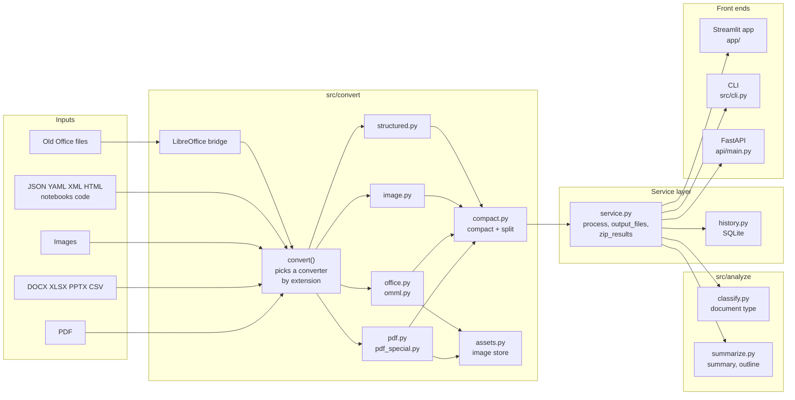
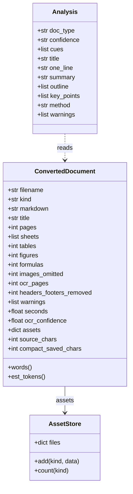
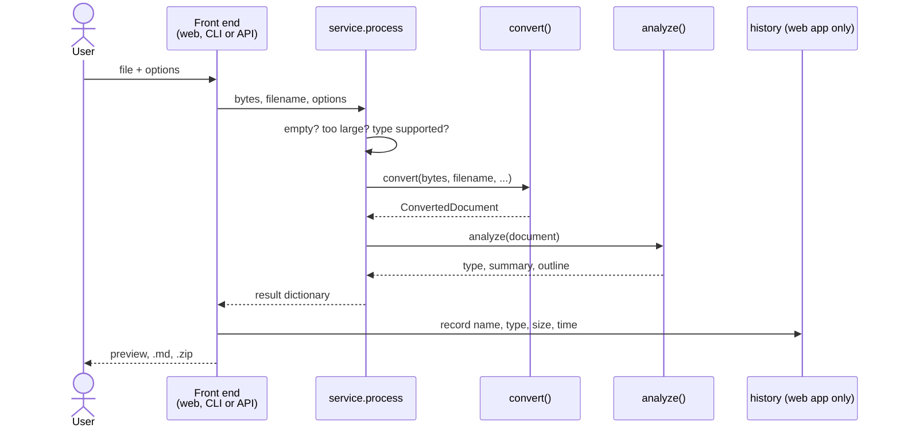
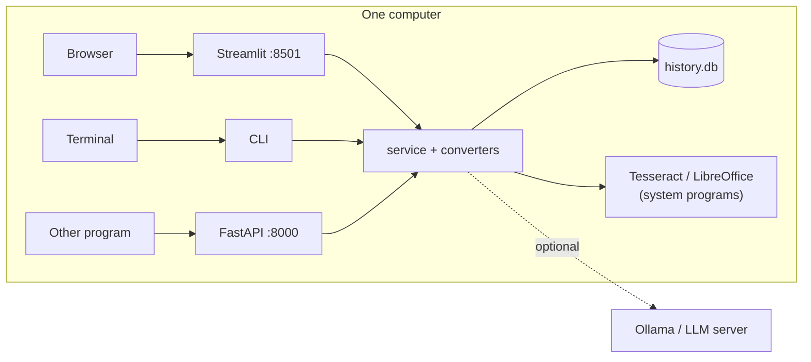

# 04 - System Architecture

## Full architecture

Pre-drawn versions of this diagram are in [`docs/assets`](assets/) (`01_architecture.png`).

## Three layers

| Layer | Folder | Job | Knows about |
|---|---|---|---|
| Conversion | `src/convert/` | Bytes plus a file name become a `ConvertedDocument` | Parsers only |
| Analysis | `src/analyze/` | Decide the document type, write the summary | The Markdown text |
| Delivery | `src/service.py`, `src/cli.py`, `api/`, `app/` | Check requests, call the layers, package results | The two layers above |

Dependencies point one way. The converters do not know about analysis. The front ends do not know about parsers. Replacing Streamlit would change only the `app/` folder.

## Modules

| File | Lines | Responsibility |
|---|---:|---|
| `src/convert/base.py` | 114 | `ConvertedDocument`, `ConversionError`, `estimate_tokens`, table helpers, text cleaning |
| `src/convert/__init__.py` | 130 | `convert()` dispatch, accepted types, LibreOffice bridge |
| `src/convert/pdf.py` | 669 | Rows, columns, headings, lists, tables, header and footer removal, OCR fallback |
| `src/convert/pdf_special.py` | 243 | Figures and display equations of a PDF page, saved as images |
| `src/convert/office.py` | 464 | DOCX, XLSX, PPTX, CSV, text decoding |
| `src/convert/omml.py` | 142 | Word equations to LaTeX |
| `src/convert/image.py` | 228 | Image preparation, Tesseract, layout rebuilding |
| `src/convert/structured.py` | 422 | JSON, YAML, TOML, XML, notebooks, HTML, code, Google shortcut files |
| `src/convert/compact.py` | 140 | Compact mode and splitting by token budget |
| `src/convert/assets.py` | 61 | `AssetStore`: names and keeps image files |
| `src/analyze/classify.py` | 108 | Document type by weighted keyword cues |
| `src/analyze/summarize.py` | 286 | Extractive summary, outline, optional AI summary check |
| `src/llm/client.py`, `cost.py` | 143, 38 | Optional AI clients and cost estimates |
| `src/service.py` | 126 | `process()`, `public()`, `output_files()`, `zip_results()`, `health()` |
| `src/slides.py` | 174 | Slide-by-slide reading: original picture, text and line positions (PDF, PowerPoint, Word, images) |
| `src/desktop_model.py` | 104 | Desktop state: edits, text-to-slide links, geometry |
| `app/desktop.py` | 370 | Desktop window (Tkinter) |
| `src/history.py` | 110 | SQLite record of conversions |
| `src/cli.py` | 121 | Command line |
| `api/main.py` | 82 | FastAPI endpoints |
| `app/streamlit_app.py`, `app/ui.py`, `app/views/*` | 29, 123, 444 | Web app: entry, look, four pages |

## The shared data object

Every converter returns the same object. That is why the rest of the system does not care about the file format.

`kind` is one of `pdf`, `docx`, `xlsx`, `pptx`, `csv`, `image`, `text`, `json`, `yaml`, `toml`, `xml`, `notebook`, `html`, `code`.

## Data flow of one request

Splitting by token budget happens late, in `output_files()`, because it only matters when files are handed over.

## Error mapping

| Situation | Code | Meaning |
|---|---|---|
| Empty file | 400 | Nothing to read |
| File over `MAX_UPLOAD_MB` (50 by default) | 413 | Too large |
| Extension not supported | 415 | Unsupported type |
| Corrupt, encrypted, invalid file; bad option | 422 | Could not convert |

## Deployment view

Everything runs in one Python process per interface. Nothing is sent out unless the optional AI summary is configured.

---
Previous: [03 Technology Stack](03_technology_stack.md) · Next: [05 Internal Workflow](05_internal_workflow.md)
