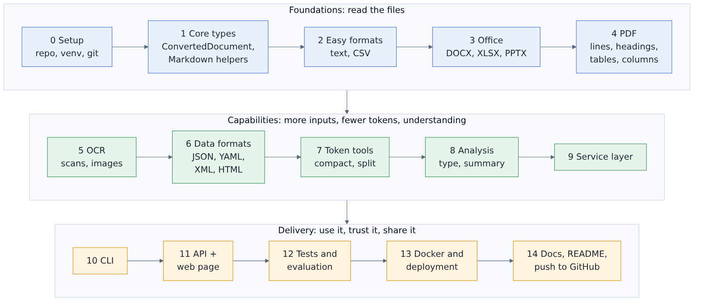
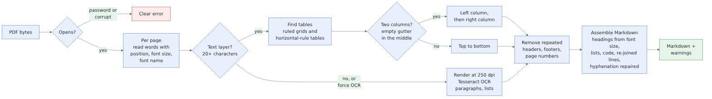
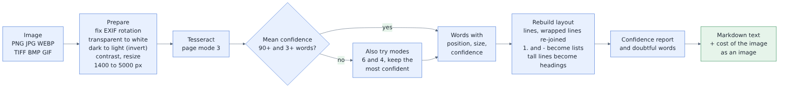
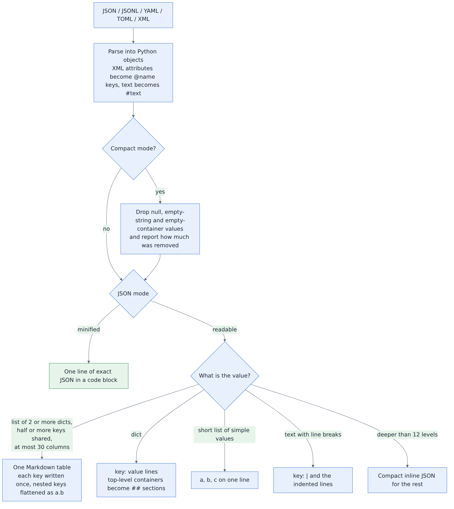
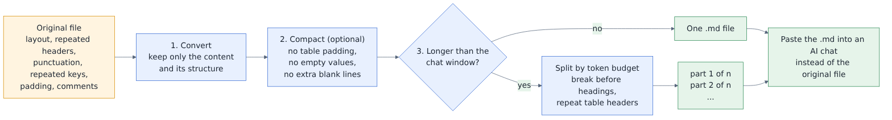
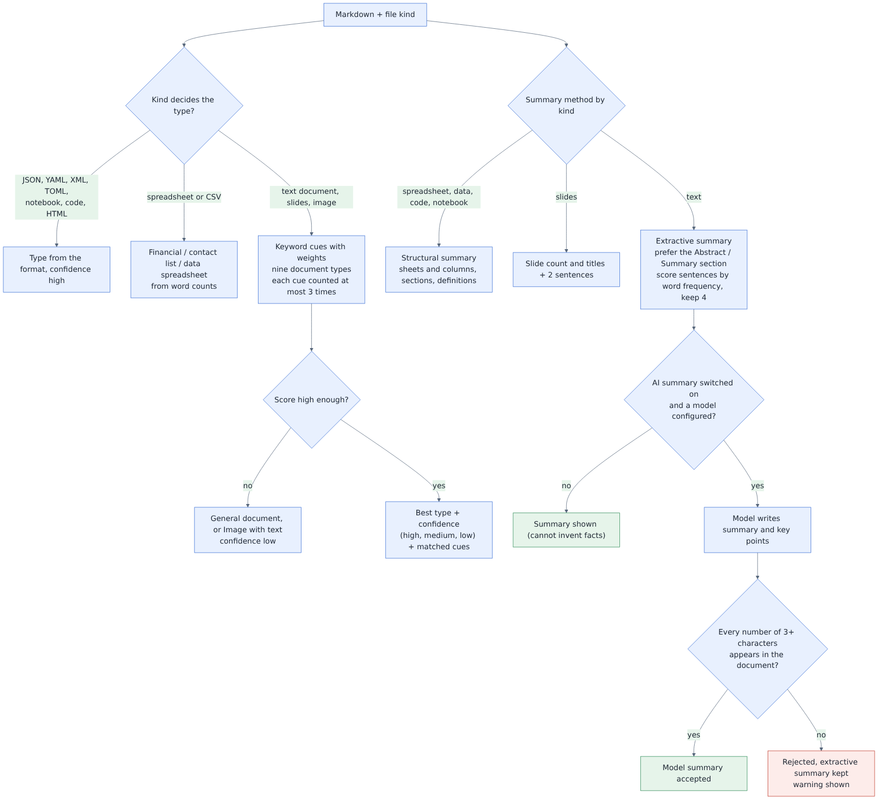

# 05 - Build it from scratch, start to finish

This is a learning path, not a download. Each phase explains the *idea* first, then the steps, then a way to *check*
that the step works, then a commit. The repository holds a finished version of every file for comparison, but the
learning comes from typing each piece, running it and breaking it on purpose.



*Roadmap: 15 phases, each ending in a commit.*

## How to use this guide

| Habit | Why |
|---|---|
| Type the code instead of pasting it | Typing forces every line to be read; errors become lessons |
| Read the idea section before the code | Each design choice has a reason, and the reason transfers to other projects |
| Run the "Check" step before moving on | A bug found one phase later costs ten times as much |
| Commit at the end of every phase | History becomes a readable diary; any phase can be revisited with `git checkout` |
| Do the "Try to break it" exercise | Understanding is tested by predicting what fails |
| Compare with the repository file *after* writing a version | Differences show alternative solutions and missed corner cases |

Estimated effort: 25 to 40 hours for all phases at a relaxed pace. Phases 4 (PDF) and 5 (OCR) are the longest.

## Phase 0 - Prepare the workspace

**Goal:** an empty project that runs Python, tests and Tesseract, tracked by git.

Install the tools (Ubuntu/Debian; macOS: `brew install python tesseract git`):

```bash
sudo apt update
sudo apt install -y python3 python3-venv python3-pip git tesseract-ocr
sudo apt install -y libreoffice-writer libreoffice-calc libreoffice-impress   # optional: old .doc/.xls/.ppt files and sample generation
python3 --version        # 3.11 or newer (the TOML reader needs the tomllib module added in 3.11)
tesseract --version
```

Create the project:

```bash
mkdir ai-document-analyst && cd ai-document-analyst
git init -b main
python3 -m venv .venv
source .venv/bin/activate                  # every new terminal needs this line again
mkdir -p src/convert src/analyze src/llm api app tests scripts data/samples docs prompts
touch src/__init__.py src/convert/__init__.py src/analyze/__init__.py src/llm/__init__.py api/__init__.py tests/__init__.py
```

Create `.gitignore`:

```gitignore
__pycache__/
*.py[cod]
.venv/
.env
.pytest_cache/
.DS_Store
.streamlit/secrets.toml
```

Install the libraries, then record them in `requirements.txt` (hand-written, with a comment per group):

```bash
pip install pdfplumber python-docx openpyxl python-pptx pytesseract Pillow beautifulsoup4 PyYAML requests
pip install streamlit fastapi uvicorn python-multipart
```

**Check:** `python -c "import pdfplumber, docx, openpyxl, pptx, pytesseract, bs4, yaml; print('ok')"` prints `ok`.

**Commit:** `chore: project skeleton, .gitignore, requirements`

> **Why a virtual environment?** Modern Linux distributions refuse `pip install` into the system Python
> (`externally-managed-environment`). A venv gives the project its own library folder, so versions never clash with other work.

## Phase 1 - Core types: one object for every format

**Goal:** a single `ConvertedDocument` that every converter returns, plus small Markdown helpers.

**Idea.** The UI, the API and the command line must not care whether a result came from a PDF or a spreadsheet. If every
converter returns the same shape, front ends are written once. This is the most important design decision in the project.

Create `src/convert/base.py`. Start with the data object (fields are added later as features arrive):

```python
from dataclasses import dataclass, field
import re

class ConversionError(ValueError):
    """The file cannot be converted (unsupported, corrupt, encrypted...)."""

@dataclass
class ConvertedDocument:
    filename: str
    kind: str                       # pdf | docx | xlsx | pptx | csv | image | text | json ...
    markdown: str
    title: str | None = None
    pages: int | None = None
    sheets: list[str] = field(default_factory=list)
    tables: int = 0
    images_omitted: int = 0
    warnings: list[str] = field(default_factory=list)
    seconds: float = 0.0
    size_bytes: int = 0

    @property
    def words(self) -> int:
        return len(re.findall(r"\w+", self.markdown))
```

Then the helpers below (simplified: the repository versions of `md_cell` and `md_table` also call `clean_chars` and drop empty trailing columns).
They are small, but every later phase depends on them:

```python
def estimate_tokens(text: str) -> int:
    """About 4 characters per token for English, about 1.5 for other scripts. A planning figure."""
    if not text.strip():
        return 0
    ascii_chars = sum(1 for c in text if ord(c) < 128)
    return max(1, round(ascii_chars / 4 + (len(text) - ascii_chars) / 1.5))

def md_cell(v) -> str:
    """Make a value safe inside a Markdown table cell."""
    if v is None:
        return ""
    s = str(v).replace("\r\n", "\n").replace("\r", "\n").strip()
    return s.replace("|", "\\|").replace("\n", "<br>")

def md_table(rows: list[list]) -> str:
    """Rows -> Markdown table; the first row is the header."""
    width = max(len(r) for r in rows)
    rows = [list(r) + [""] * (width - len(r)) for r in rows]
    out = ["| " + " | ".join(md_cell(c) for c in rows[0]) + " |",
           "| " + " | ".join("---" for _ in rows[0]) + " |"]
    out += ["| " + " | ".join(md_cell(c) for c in r) + " |" for r in rows[1:]]
    return "\n".join(out)

def tidy(md: str) -> str:
    """Collapse 3+ blank lines, strip trailing spaces, end with exactly one newline."""
    md = re.sub(r"[ \t]+\n", "\n", md)
    md = re.sub(r"\n{3,}", "\n\n", md)
    return md.strip() + "\n" if md.strip() else ""
```

Also add `clean_chars`: PDFs and Word files often contain typographic ligatures (`fi`, `fl`), soft hyphens and non-breaking
spaces that break searching and cost tokens. Map them to plain text with a dictionary (`"\ufb01": "fi"`, `"\u00ad": ""`, `"\u00a0": " "`).
The repository version also repairs `(cid:12)`-style placeholders that LaTeX-made PDFs produce (function `fix_cids`); that
is a later discovery, added when a real sample failed.

**Check:** write `tests/test_base.py` with three assertions: `md_table([["a","b"],["1","2"]])` gives the expected three lines;
a cell containing `|` is escaped; `tidy("a\n\n\n\nb")` gives `"a\n\nb\n"`.

**Try to break it:** pass a row shorter than the header to `md_table`. Why does padding to a common width matter for rendering?

**Commit:** `feat(base): ConvertedDocument, token estimate, Markdown table helpers`

## Phase 2 - Dispatch, text and CSV

**Goal:** `convert(data: bytes, filename: str)` that chooses a converter from the file extension; the first two formats.

**Idea.** Dispatch on the extension, not on content sniffing: simple, predictable, easy to explain. Converters receive
*bytes*, not paths, so the same function serves uploads (memory) and the command line (files read once).

Create `src/convert/__init__.py`:

```python
from pathlib import Path
from .base import ConversionError, ConvertedDocument, tidy
from .office import convert_csv, _decode

def convert(data: bytes, filename: str) -> ConvertedDocument:
    if not data:
        raise ConversionError("empty file")
    ext = Path(filename or "").suffix.lower()          # ".PDF" and ".pdf" are the same
    if ext in (".csv", ".tsv"):
        return convert_csv(data, filename)
    if ext in (".txt", ".md"):
        text = _decode(data)
        return ConvertedDocument(filename, "text", tidy(text), size_bytes=len(data))
    raise ConversionError(f"unsupported file type {ext or '(none)'}")
```

**Text decoding is a real problem.** Files arrive in UTF-8, Windows-1252 (Excel on Windows), UTF-16 (some exports) and more.
Guessing wrongly turns `René` into `René`. The repository's `_decode` encodes a rule learned the hard way:

```python
def _decode(data: bytes) -> str:
    if data[:2] in (b"\xff\xfe", b"\xfe\xff"):          # trust UTF-16 only when a byte-order mark says so
        try:
            return data.decode("utf-16")
        except UnicodeDecodeError:
            pass
    for enc in ("utf-8-sig", "cp1252", "latin-1"):      # utf-8-sig also strips a BOM
        try:
            return data.decode(enc)
        except UnicodeDecodeError:
            continue
    return data.decode("utf-8", errors="replace")
```

Why not try UTF-16 first? Almost any byte string decodes as UTF-16, so blind trial turns Windows-1252 text into garbage.
For CSV, `csv.Sniffer().sniff(text[:4096], delimiters=",;\t|")` detects the delimiter (European Excel uses `;`), with `csv.excel`
as the fallback. Cap the row count (5,000 in the repository) and add a warning when truncating.

**Check:** convert a Windows-1252 CSV containing `René,Zürich`; a UTF-16 CSV; a semicolon CSV. All should give correct tables.

**Commit:** `feat(convert): dispatch by extension, text and CSV, robust decoding`

## Phase 3 - Word, Excel, PowerPoint

**Goal:** `convert_docx`, `convert_xlsx`, `convert_pptx` in `src/convert/office.py`.

### 3a. DOCX (python-docx)

**Idea.** Document order matters. `doc.paragraphs` and `doc.tables` are separate lists; iterating both loses the place of
each table. Walk the underlying XML body instead:

```python
for child in doc.element.body.iterchildren():
    tag = child.tag.rsplit("}", 1)[-1]          # strip the XML namespace
    if tag == "p":      ...  # paragraph: heading, list item or text
    elif tag == "tbl":  ...  # table
```

Decisions per paragraph:

| Signal | Markdown |
|---|---|
| Style name `Heading N` (regex `heading (\d)`) | `#` x N. If the file has a `Title` style, headings shift down one level so the title stays the only `#` |
| Numbering properties (`numPr`) present | List item. Look up the numbering definition: format `bullet` gives `-`, anything else gives `1.`; the level gives indentation |
| Runs with bold/italic | `**bold**`, `*italic*`. Adjacent runs with the same format are merged (`**a****b**` becomes `**ab**`) |
| Hyperlink | `[text](url)` |
| Table | `md_table` with merged cells blanked (track cell identity to avoid repeating a merged cell) |

Warn about what is not converted: pictures, and headers, footers, footnotes and text boxes.

**Check:** generate a document with `python-docx` (heading, bullets, numbered list, a table) and compare the Markdown by eye.
Later phases automate this with ground-truth files.

### 3b. XLSX (openpyxl)

**Idea.** A formula cell has two values: the formula and the result Excel cached. Load the workbook **twice**:
`data_only=True` gives cached results; `data_only=False` gives formulas. When the cached value is `None` and the formula
exists, the workbook was never recalculated (for example, generated by a script): show the formula and warn with a count.

Other rules: skip hidden sheets (warn); cap 5,000 rows and 60 columns (warn); trim empty trailing columns; split a sheet
into several tables at fully empty rows; one `## Sheet name` heading per sheet; `*(empty sheet)*` for blanks; format
dates as ISO text and floats without `.0`.

### 3c. PPTX (python-pptx)

**Idea.** Slides are free-form shapes, not a flow. Sort shapes by reading position, `(round(top / 228600), left)` where
228,600 EMU is a quarter inch, so shapes in the same visual row sort left to right. Emit `## Slide N: title`, bullets with
nesting (`"  " * paragraph.level`), tables, charts as tables (categories and series values), and speaker notes as a
blockquote. Group shapes are walked recursively; pictures are counted and reported.

**Check:** use LibreOffice or PowerPoint to make a three-slide deck with bullets, a table and notes.

**Try to break it:** open a `.xlsx` that was saved by a script with formulas and no cached values. Which warning appears?

**Commit:** `feat(office): DOCX, XLSX, PPTX converters with warnings`

## Phase 4 - PDF: the hardest converter

**Goal:** `convert_pdf` in `src/convert/pdf.py`, producing headings, paragraphs, lists, tables, code, in the right order.

**Idea.** A PDF is a list of glyphs placed at coordinates. Nothing in it says "paragraph" or "heading". Everything must be
*inferred from geometry*: position, font size, font name. Build it in layers; each layer has its own Check.



### 4a. Read words with their fonts

```python
import pdfplumber, io
with pdfplumber.open(io.BytesIO(data)) as pdf:
    for page in pdf.pages:
        words = page.extract_words(x_tolerance=3, y_tolerance=2, extra_attrs=["size", "fontname"])
```

Print the first 20 words of a sample page: each has `text`, `x0`, `x1`, `top`, `bottom`, `size`, `fontname`.
**Everything below is arithmetic on these numbers.** Handle `pdfplumber.open` failures: a password-protected file must
produce the message `this PDF is password-protected; remove the password and try again`, not a stack trace.

### 4b. Words to rows to lines

Cluster words into visual rows by their vertical centre. A word joins the current row when its centre is within
`0.55 x font size` of the row's average centre:

```python
def rows_of(words):
    ws = sorted(words, key=lambda w: ((w["top"] + w["bottom"]) / 2, w["x0"]))
    rows = []
    for w in ws:
        cy = (w["top"] + w["bottom"]) / 2
        if rows:
            r = rows[-1]
            rcy = sum((x["top"] + x["bottom"]) / 2 for x in r) / len(r)
            if abs(cy - rcy) <= 0.55 * max(max(x["size"] for x in r), w["size"]):
                r.append(w)
                continue
        rows.append([w])
    return [sorted(r, key=lambda w: w["x0"]) for r in rows]
```

Then join a row's words, inserting a space where the gap between words exceeds `0.12 x font size`. The constant matters:
justified text squeezes word gaps to about 0.15 em, while kerning *inside* a word stays under 0.05 em, so 0.12 separates them.
The same constant is used to split words *and* to put spaces back, so the two steps cannot disagree.

**Check:** print the rows of a one-column sample. It should read like the page.

### 4c. Classify lines

Compute the **body size**: the most common font size weighted by character count. Then, per line:

| Rule | Result |
|---|---|
| Size >= body x 1.15 + 0.3, at most 200 characters | Heading. Level = rank among the distinct larger sizes (capped at 4) |
| All words bold, at most 100 characters and 14 words, no ending `, ; . ? !`, not a bullet | Heading (one level below size-based headings) |
| Starts with a bullet glyph or `1.` / `1)` | List item (a symbol-font bullet is normalised to `•`) |
| Every word in a monospace font (name contains `mono`, `courier`, `consolas`...) | Code line; consecutive code lines become a fenced block, indentation from x-offset / (0.6 x size) |
| Anything else | Paragraph text |

### 4d. Lines to paragraphs

A new paragraph starts when: the vertical gap to the previous line exceeds `0.45 x size`; or the line is indented relative to
the previous one after a finished sentence; or it begins a list item or a reference (`[12] ...`). Otherwise the line continues
the paragraph. When joining, repair end-of-line hyphenation: if the previous line ends with `-` after a letter and the next
starts with a lowercase letter, delete the hyphen and join without a space (`informa-` + `tion`).

Consecutive list items are merged with single newlines so that they render as one list.

### 4e. Tables

Two detectors:

1. **Ruled grids:** `page.find_tables()`. Accept a table when it has at least 2 rows, 2 columns and at least 40% non-empty
   cells (this rejects decorative boxes).
2. **Horizontal-rule tables** (LaTeX `booktabs`, many reports): find long horizontal lines (more than 20% of the page width)
   that share the same x-extent (within 8 points); two or more such rules within 300 points enclose the table. Columns are the
   empty vertical strips between words (gap of at least `max(6, 0.9 x median size)`). Accept if at least 60% of rows have two
   or more non-empty cells.

Remove table words from the text stream so they are not emitted twice.

### 4f. Two columns

Count, for every x position, how many rows have a word covering it (a *coverage* histogram). A gutter is a run of low coverage
(30% of rows or fewer) in the middle 35% to 65% of the page width:

```python
cover = [0] * (int(width) + 1)
for r in rows:
    seen = {x for w in r for x in range(int(w["x0"]), int(w["x1"]) + 1)}
    for x in seen:
        cover[x] += 1
# find the widest run of x in [0.35*width, 0.65*width] with cover[x] <= 0.30 * len(rows)
```

Before accepting: the page must have at least 12 rows; the gutter must be at least 8 points wide; each side must hold at least 25% of the
words; and the evidence must be strong: a row counts as *split* when the gap between its left and right words is at least
`max(6 pt, 0.6 x gutter width)`, and there must be at least 6 split rows, at least twice as many as full-width rows. The 30% coverage threshold
is what tolerates a full-width title and abstract above a two-column body. Reading order: full-width rows in place; between them, the left
column top to bottom, then the right column.

### 4g. Headers, footers, page numbers

Look only at lines in the top or bottom 8% of the page. Normalise the text by replacing digits with `#`. A line is dropped when
it is a bare page number (`3`, `Page 3`, `3 / 10`), or, in a document of at least three pages, when its normalised text appears
on at least three pages and at least half of all pages. Report the count removed.

### 4h. Scanned pages and rotated text

A page with fewer than 20 characters of text has no text layer: render it (`page.to_image(resolution=250)`), convert to grey,
and OCR it (Phase 5 explains OCR). Vertical margin stamps (arXiv) and upside-down text are read in their true direction using the
glyph transform matrix, moved to the end of the page, and reported; diagonal watermarks are skipped and reported.

**Check:** the sample documents in `data/samples/` (Phase 12 creates them). Compare each output with `expected/*.json`.

**Try to break it:** set the word gap to `0.05` and look at the output (words split in the middle); set it to `0.3` (words run
together). Disable the gutter test on the two-column sample and read the output aloud: sentences alternate between columns.

**Commit:** `feat(pdf): layout-aware PDF converter (headings, lists, tables, columns, header/footer removal)`

## Phase 5 - Images and OCR

**Goal:** `convert_image` in `src/convert/image.py`, and the OCR fallback used by the PDF converter.



**Idea.** `pytesseract.image_to_string(img)` alone fails on real pictures. Three preparation problems appear immediately:

| Problem | Symptom | Fix |
|---|---|---|
| Transparent PNG | Transparency becomes black; OCR returns nothing | Composite onto a white background |
| Dark-mode screenshot | Light text on dark | If the average grey level is below 110, invert |
| Small or huge image | Small text unreadable; huge images slow | Enlarge below 1400 px (up to 3x), shrink above 5000 px |

Also apply `ImageOps.exif_transpose` (phone photos carry an orientation flag) and `ImageOps.autocontrast(g, cutoff=1)`.

**Read words with positions, not just text.** `pytesseract.image_to_data(..., output_type=Output.DICT)` returns, per word, the box,
the confidence and block/paragraph/line numbers. Position is what allows structure to be rebuilt.

**Try several page-segmentation modes.** Mode 3 is automatic layout; modes 6 (single block) and 4 (single column) do better on
some screenshots. Run mode 3; if its mean confidence is at least 90 with at least 3 words, stop. Otherwise also run 6 and 4 and keep
the result with the largest *sum of confidences above 30* (rewards both quantity and quality).

**Rebuild the layout** (`layout_to_markdown`):

- Group words by `(block, paragraph, line)` into lines; sort lines.
- A new block starts when the paragraph key changes or the vertical gap exceeds `0.9 x median line height`.
- A line **continues** the previous one (a wrapped paragraph) only if the previous line ran to the right margin (right edge at
  least 0.88 of the widest line), did not end with `. : ; ! ?`, and the new line does not look like a label (`Date: ...`).
  The label rule fixes a real bug: without it, `Meeting notes` and `Date: 12 March` merged into one line.
- Lines starting `1.` or `-` become list items. A line at least 1.45x taller than the median with at most 12 words becomes `## heading`.

**Report quality.** Mean confidence of all words; if below 85, warn and name up to 8 words under 60. If no text was found, warn that
the image may be a photo, chart or diagram and that the image itself should be sent instead.

**Languages.** Tesseract needs a language pack per language (`tesseract-ocr-ben` for Bangla). `check_language` calls
`pytesseract.get_languages()` and, when a pack is missing, raises a message naming the package to install.

**Multi-page images.** GIF and TIFF can hold many frames; read at most 20 and warn when more exist.

**Check:** make test images with Pillow (`ImageDraw.text`), including a dark one and a transparent one
(`scripts/make_image_samples.py` shows how). The text must come out, and `Meeting notes` and `Date:` must stay on separate lines.

**Try to break it:** comment out the invert step and OCR the dark image; comment out the white-background step and OCR the transparent one.

**Commit:** `feat(image): OCR with preparation, layout reconstruction, confidence and language checks`

## Phase 6 - Data, web and code files

**Goal:** `src/convert/structured.py` for JSON, JSONL, YAML, TOML, XML, notebooks, HTML, source code, and the Google-file message.



**Idea.** JSON spends tokens on punctuation and repeated keys. A list of similar records fits a table where each key is written
once. Everything parses into Python objects first (`json.loads`, `yaml.safe_load_all`, `tomllib.loads`, `xml.etree`), then one
renderer handles all of them:

| Value | Rendering |
|---|---|
| List of 2 or more dicts, average key overlap with the first record at least 0.5, at most 30 distinct keys | One Markdown table. Nested dicts of scalars are flattened (`address.city`) |
| Dict | `key: value` lines. At the top level, a container value becomes a `## key` section |
| Short list of simple values (at most 120 characters, no commas inside) | `a, b, c` on one line |
| String with line breaks | `key: |` followed by indented lines |
| Deeper than 12 levels | Compact inline JSON for the remainder |
| Table nested deeper than level 1 | Indented plain `a \| b` lines, because an indented table is not valid Markdown |

`json_mode="minified"` skips all of this and writes one line of exact JSON in a code block.

**Format details.**

- **JSONL**: if `json.loads` of the whole text fails, parse line by line; the result is a list.
- **YAML**: `safe_load_all` (never `load`, which can execute code). Several documents become a list.
- **XML**: attributes become `@name` keys, text becomes `#text`, repeated tags become lists. Refuse any file containing
  `<!ENTITY`: entity declarations enable "billion laughs" memory attacks.
- **Notebook (`.ipynb`)**: JSON with `cells`. Keep Markdown cells, code cells in fences with the notebook's language, text
  outputs; drop image outputs (count them); cut outputs longer than 40 lines.
- **HTML** (BeautifulSoup, `html.parser`): drop `script`, `style`, `nav`, `footer`, `aside`, `form`, `svg`, `iframe` and similar;
  prefer `<article>` or `<main>`; convert headings, paragraphs, nested lists, tables, `<pre>`, quotes, bold, italic, inline code;
  keep image alt text; drop link addresses (count them in a warning). Warn when no text remains (JavaScript-built pages).
- **Code files**: wrap in a fence with the language from the extension; use four backticks when the code itself contains three.
- **Google files**: `.gsheet` and siblings are small JSON files holding a URL, not data. Raise an error that names the export route
  (`File > Download > Microsoft Excel (.xlsx)`).

**Check:** convert the generated `users.json` three ways and compare character counts: indented, minified mode, readable mode.

**Try to break it:** feed records with completely different keys (the overlap rule should refuse a table); a 20-level nested object;
an XML file with an entity.

**Commit:** `feat(structured): compact JSON/YAML/TOML/XML rendering, notebooks, HTML, code, Google pointer error`

## Phase 7 - Token tools: compact and split

**Goal:** `src/convert/compact.py`.



### Compact mode

Remove only what carries no information, and **never touch code blocks** (track fence state while scanning lines):

- table lines: split cells (respecting `\|` escapes), drop the alignment row, join with `" | "`;
- HTML comments (`<!-- page 2 -->`);
- repeated spaces and tabs; runs of three or more blank lines.

For data files also drop `null`, `""`, `[]`, `{}` values before rendering, and report how many characters this removed. Compact
must be **idempotent**: compacting twice equals compacting once (tested).

### Split by token budget

Goal: parts of about N tokens that can be pasted one after another.

1. Break the Markdown into blocks at blank lines, keeping fenced code and tables in one block.
2. A block larger than the budget is split by lines (a table keeps its header on every piece; a single enormous line is cut by characters).
3. Pack blocks greedily. Start a new part when adding the next block overflows the budget, **but** avoid tiny parts: overflow counts only when
   the current part is at least 25% full or the addition would exceed 115% of the budget. Also start a new part before a heading when the current
   part is more than 60% full, so sections stay together.
4. Prefix each part with `(part i of n)` so a chatbot knows what it is reading.

**Check:** split the two-column sample paper with a 1,500-token budget: 3 parts (about 945, 1,241 and 418 estimated tokens), none cutting a table or heading in half.

**Commit:** `feat(tokens): compact mode and split by token budget`

## Phase 8 - Understanding: type, summary, outline

**Goal:** `src/analyze/classify.py` and `summarize.py`.



### Classifier (no machine learning)

A dictionary maps each type to `(regex, weight)` cues. Score = sum of `weight x min(count, 3)`. Headings are appended to the text once more so they weigh double.
Rules after scoring: the format decides for data files, code, notebooks and HTML; spreadsheets get a sub-label from word counts
(`budget`, `revenue`... versus `name`, `email`...); a score below 4 means "General document" (or "Image with text (OCR)") with low confidence; confidence is
`high` when the score is at least 10 and 1.8 times the runner-up. The **cues are returned**, so any answer can be explained.

Why not a trained model? Rules are explainable, free, instant and testable; their weakness (only nine types) is documented.

### Extractive summary

1. Split into sentences (regex on end punctuation followed by a capital letter; re-join after abbreviations such as `et al.`).
2. Keep sentences of 6 to 70 words.
3. Score each sentence: `sum(tf[w] for meaningful words) / len(words) ** 0.6`; multiply by 1.35 for the first 3 sentences and 1.15 for the next 5.
4. Keep the top 4, in document order.

Prefer text under an *Abstract / Summary / Overview / Introduction* heading when it has at least two sentences. Spreadsheets get a structural summary
(`'Sheet': 4 data rows, columns A, B, C`), slide decks list slide titles, data files list sections and fields, code lists definitions.

### Optional AI summary

The versioned prompt lives in `prompts/summary_v1.txt` (a prompt is code: it changes behaviour, so it gets a version). The client talks to
any OpenAI-compatible endpoint (Ollama locally) or the Anthropic API through plain `requests`. The reply must parse as JSON; **every number of
three or more characters must appear in the document**, otherwise the reply is rejected with a warning and the extractive summary stays.
Long documents are sent as the first 80% plus the last 20% of the character budget, with the middle marked as omitted.

**Check:** run on the sample report: type `Business report / proposal`, a four-sentence summary, an outline of headings.

**Commit:** `feat(analyze): transparent type detection, extractive summary, optional AI summary with number check`

## Phase 9 - The service layer

**Goal:** `src/service.py`, the only module the front ends import.

```python
def process(data, filename, *, page_markers=False, strip_repeated=True, force_ocr=False, use_llm=None,
            compact=False, json_mode="readable", ocr_lang=None, max_tokens=None) -> dict: ...
def output_files(result, include_summary=False) -> list[tuple[str, str]]: ...   # one .md, or several parts
def zip_results(results, include_summary=False) -> bytes: ...
def health() -> dict: ...
```

`process` validates input (`max_tokens` at least 200, non-empty, below `MAX_UPLOAD_MB`), calls `convert` and `analyze`, converts failures to
`ServiceError(status, message)` (400 empty, 413 too large, 415 unsupported, 422 anything else that went wrong), and returns a JSON-ready dict:
`filename`, `markdown_filename`, `markdown`, `analysis`, `stats`, `max_tokens`, `warnings`. A parser crash on a malformed file is caught and reported as
a 422 instead of a 500.

`md_filename` turns an uploaded name into a safe output name (`../../etc/passwd` becomes `passwd.md`). `zip_results` de-duplicates names.

**Why a service layer?** The same checks, limits and messages apply to the web page, the API and the command line. A bug is fixed once.

**Commit:** `feat(service): shared request handling with validation and error codes`

## Phase 10 - Command line

**Goal:** `src/cli.py`, usable as `python -m src.cli`.

Flags: `-o/--out`, `--summary`, `--stdout`, `--page-markers`, `--keep-headers`, `--ocr`, `--llm`, `--compact`, `--max-tokens N`,
`--json readable|minified`, `--lang`. Decisions worth understanding:

- **Folder scan** (`collect`, set `FOLDER_EXTS`) picks up documents, spreadsheets, slides, HTML, notebooks, old Office files and images. Plain text, Markdown,
  source code and data files (JSON, YAML, XML, TOML) are skipped because they are already text; naming such a file explicitly converts it.
- **Never overwrite** (`destination`): within one run, `report.pdf` becomes `report.md` and `report.docx` becomes `report_docx.md`; the source file is never a target.
- **Exit codes:** 0 success, 1 at least one file failed, 2 nothing to convert. Scripts and CI can rely on them.
- Errors per file never stop the batch.

**Commit:** `feat(cli): batch conversion with folder scan, safe output names and exit codes`

## Phase 11 - API and web page

### API (`api/main.py`, FastAPI)

| Endpoint | Returns |
|---|---|
| `GET /health` | status, supported types, whether an AI model is configured, upload limit |
| `POST /analyze` | type, summary, outline, stats (no Markdown body) |
| `POST /convert` | the above plus the Markdown and its parts, as JSON |
| `POST /convert/download` | the `.md` file itself, or a `.zip` when `max_tokens` splits it |

Options are form fields (`compact`, `json_mode`, `ocr_lang`, `max_tokens`, `page_markers`, `keep_headers`, `force_ocr`, `use_llm`). `ServiceError` becomes
`HTTPException(status, message)`. The interactive documentation appears at `/docs`.

### Web page (`app/streamlit_app.py`, Streamlit)

One page: sidebar options; a multi-file uploader; a **Convert** button; per file an expander with the type, metrics (words, estimated tokens with the change versus the raw
file, tables, time or OCR confidence), the summary, warnings, a download button, and tabs for raw Markdown, rendered preview and outline. Results live in
`st.session_state` so that clicking a download button (which reruns the script) does not lose them. A `.zip` is offered for several files or split parts.

**Check:** `streamlit run app/streamlit_app.py` and `uvicorn api.main:app --reload`; upload a PDF, a PNG and a JSON. Then:
`curl -F file=@data/samples/report.pdf http://localhost:8000/analyze`.

**Commit:** `feat(api,ui): FastAPI endpoints and Streamlit page`

## Phase 12 - Tests and evaluation

**Goal:** proof that the converters work, and a way to notice when a change breaks something.

### Synthetic samples with known content

`scripts/make_samples.py` creates documents *together with a ground-truth file* (`data/samples/expected/*.json`: words, ordered paragraph anchors, headings,
tables, list items). LibreOffice renders DOCX to PDF and recalculates the spreadsheet, so the samples are realistic files from a real office suite. Synthetic text
means exact ground truth and no privacy problems. The cost: results measured on them say little about arbitrary real documents.

### Unit tests (`unittest`, 89 tests)

Cover each converter, the analysis, the AI clients (with stub servers, no network), the service and the CLI. Image tests skip themselves when Tesseract is missing,
API tests when FastAPI is missing. Rule: **every bug found by hand becomes a test first**, then a fix.

### Fidelity metrics (`scripts/evaluate_fidelity.py`)

| Metric | Meaning |
|---|---|
| Word recall | Share of source words present in the Markdown (low means text lost) |
| Word precision | Share of Markdown words that belong to the source (low means junk, duplicates, garbling) |
| Order | Longest in-order subsequence of paragraph anchors (low means columns interleaved) |
| Headings / tables / list items | Expected structures found as `#` lines, Markdown tables, `-`/`1.` lines |

The script also runs Microsoft's `markitdown` on the same files as a reference point.

### Corner-case runner (`scripts/corner_cases.py`)

49 awkward inputs (empty file, wrong extension, password-protected PDF, hidden Excel sheet, entity-bomb XML, 25-frame GIF...) run through the same code path as the
web page; the script prints what happened and exits non-zero if behaviour deviates. See [chapter 10](10_corner_cases_and_troubleshooting.md).

**Commit:** `test: unit tests, synthetic samples with ground truth, fidelity and corner-case scripts`

## Phase 13 - Docker and free deployment

**Dockerfile** (the repository's): `python:3.12-slim`, `apt-get install tesseract-ocr`, `pip install -r requirements.txt`, copy the project, default command
`uvicorn api.main:app`. **docker-compose.yml** defines two services from the same image: `api` (port 8000) and `ui` (port 8501, command `streamlit run ...`).
Environment variables (`LLM_MODEL`, `LLM_BASE_URL`, ...) are passed through with defaults.

Free hosting options and their limits are in [chapter 09](09_deployment_free.md). For Streamlit Community Cloud, `packages.txt` (one apt package per line) installs Tesseract.

**Check:** `docker compose up --build`, then open ports 8000 and 8501. (Docker could not be run where the repository was prepared: this phase is untested there.)

**Commit:** `build: Dockerfile, docker-compose, packages.txt for Streamlit Community Cloud`

## Phase 14 - Documentation, README, GitHub

### Documentation habits that pay off

- Write the README *after* the tool works, using real output and real numbers; every number needs a script that reproduces it.
- State limitations plainly (see the Limitations section of the README and chapter 10). Reviewers trust a project that names its weaknesses.
- Keep one source of truth: the README tells the story; the portfolio page is a shortened copy of it.

### Push to GitHub

1. Create an empty repository on github.com (no README, no licence; the project already has them).
2. Connect and push:

```bash
git remote add origin https://github.com/<GITHUB-USERNAME>/ai-document-analyst.git
git branch -M main
git push -u origin main
```

3. Authentication: HTTPS asks for a **personal access token** instead of a password (GitHub, Settings, Developer settings); or install the GitHub CLI and run `gh auth login`;
   or add an SSH key and use the `git@github.com:<GITHUB-USERNAME>/ai-document-analyst.git` address.
4. Add topics (`markdown`, `ocr`, `document-processing`, `llm-tools`, `token-optimization`) and a short description in the repository settings.
5. Tag a release: `git tag -a v1.0.0 -m "First release" && git push --tags`.

### A readable commit history

Use the commit messages listed at the end of each phase. Prefix meaning: `feat` new capability, `fix` bug fix, `test`, `docs`, `build`, `chore`.
One idea per commit; the message states *what* and the body *why*.

## Definition of done

- [ ] `python3 -m unittest discover -s tests -t .` passes
- [ ] `python scripts/corner_cases.py` reports no FAIL
- [ ] `python scripts/evaluate_fidelity.py` reproduces the numbers quoted in the README
- [ ] Each format in [chapter 06](06_user_manual.md) converts through the web page, the API and the CLI
- [ ] The Streamlit page and the API were started at least once and the first-run checklist in chapter 08 completed
- [ ] README placeholders replaced (username, name, screenshots), all links checked
- [ ] No private document in the repository; samples are synthetic

## Stretch goals (after the first version)

1. Password gate for the web page using `st.secrets`.
2. Table detection for PDFs without ruling lines.
3. A real tokenizer option (`tiktoken` or the model's own) alongside the estimate.
4. Describe pictures with a local vision model and embed the description.
5. Side-by-side viewer: original page next to the Markdown.
6. Batch mode that writes one combined `.md` for a folder, with a table of contents.
