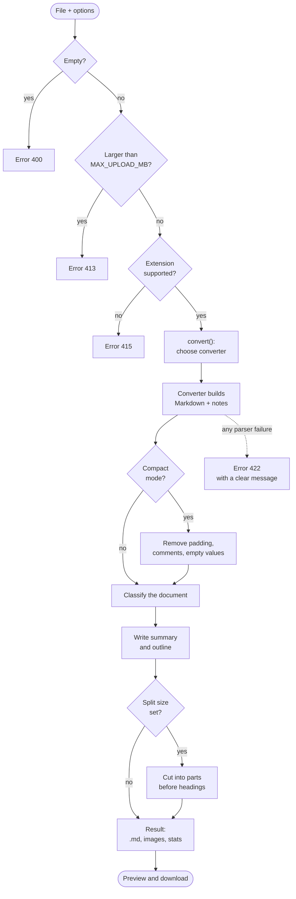
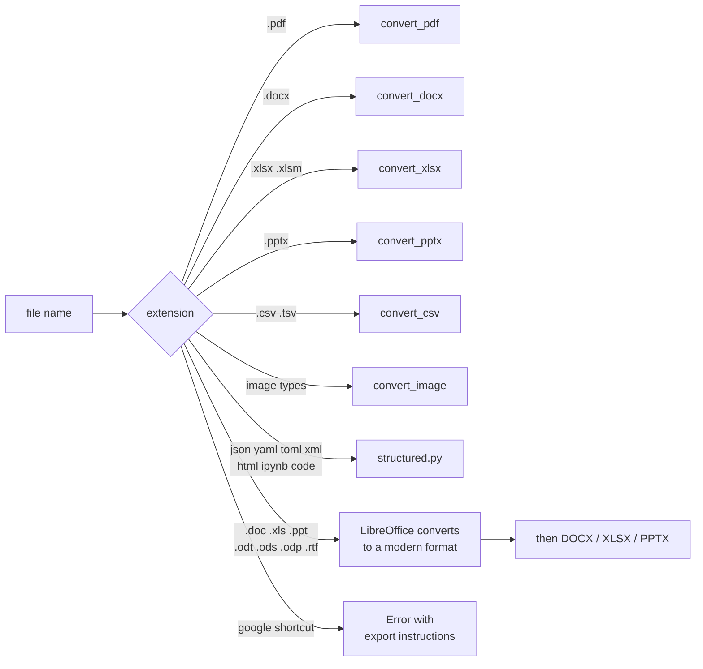
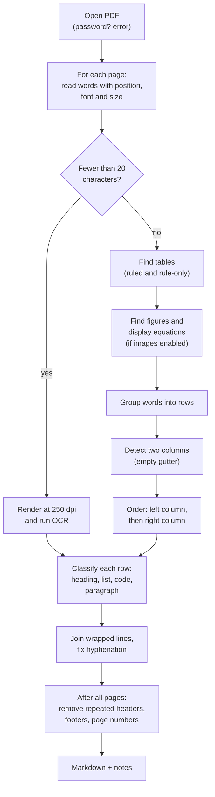
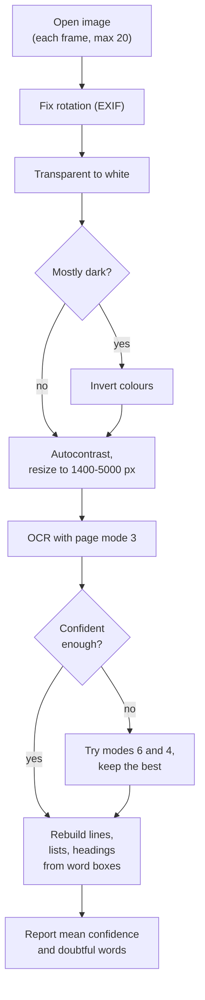
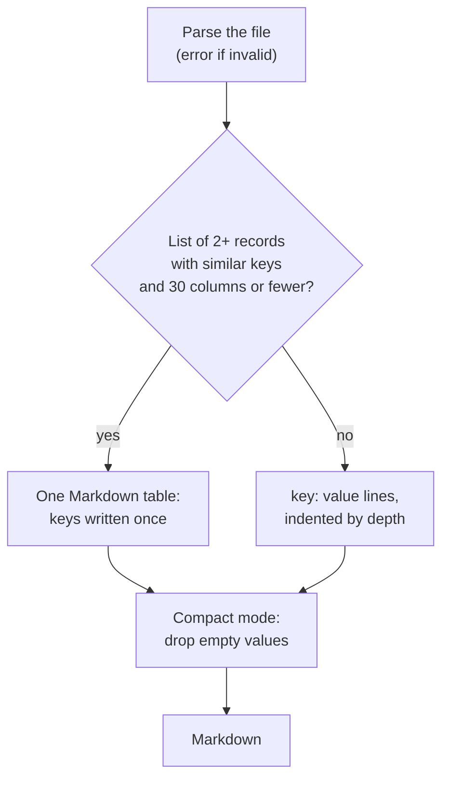
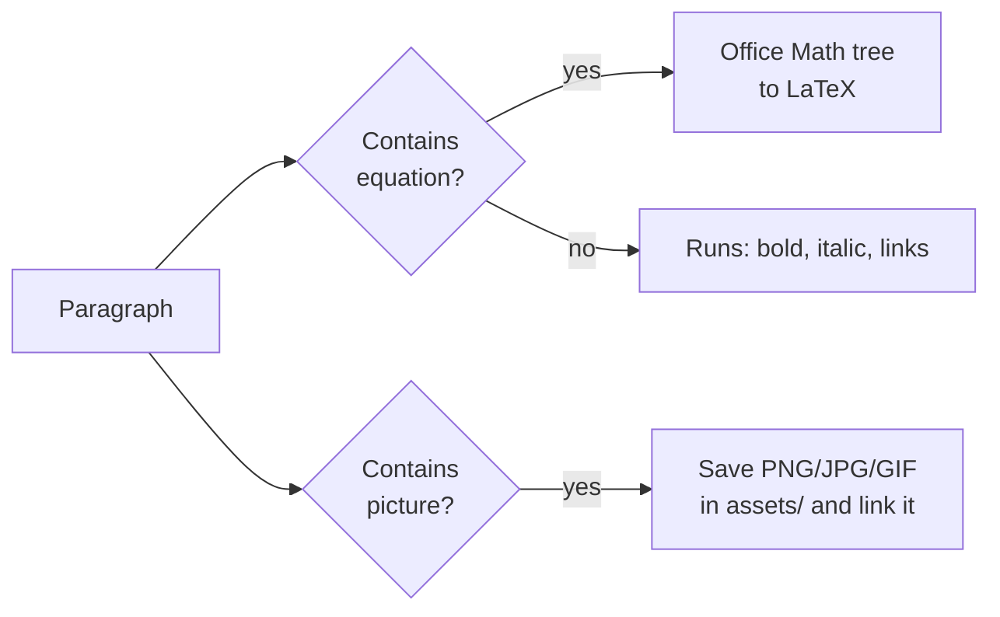
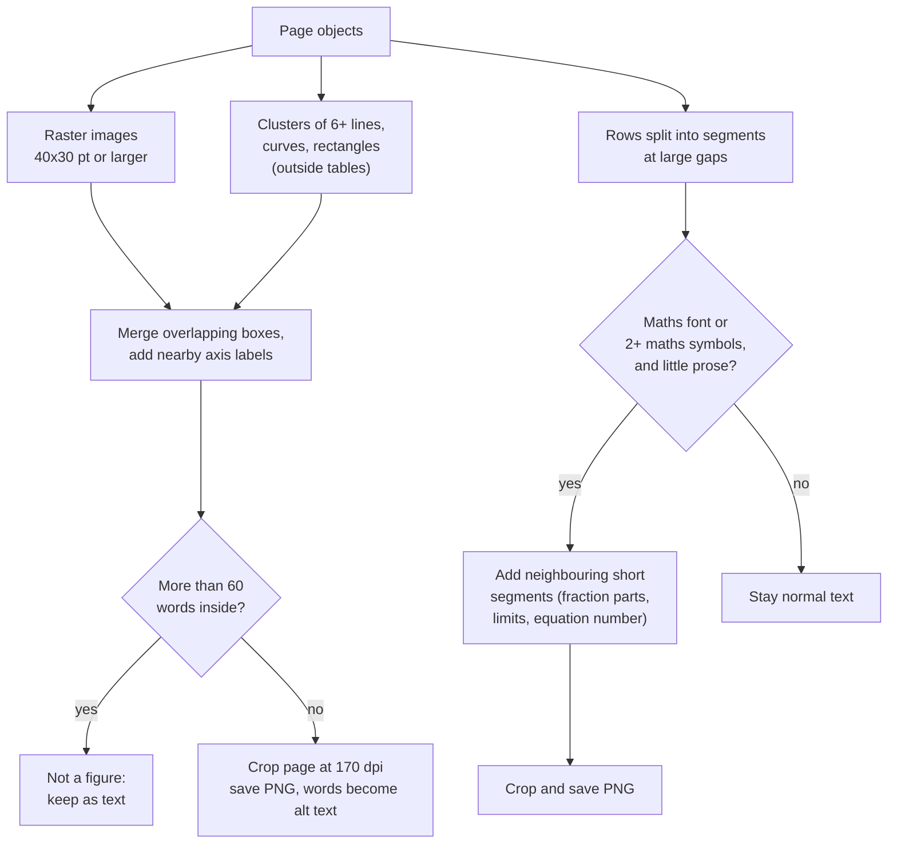
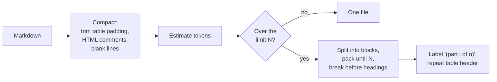
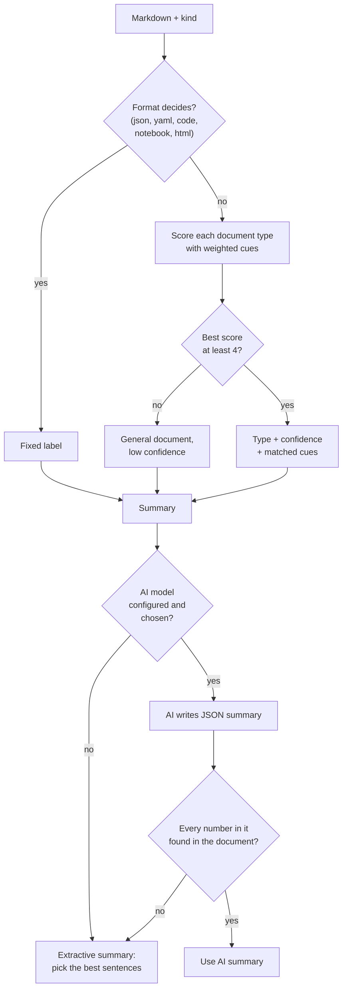
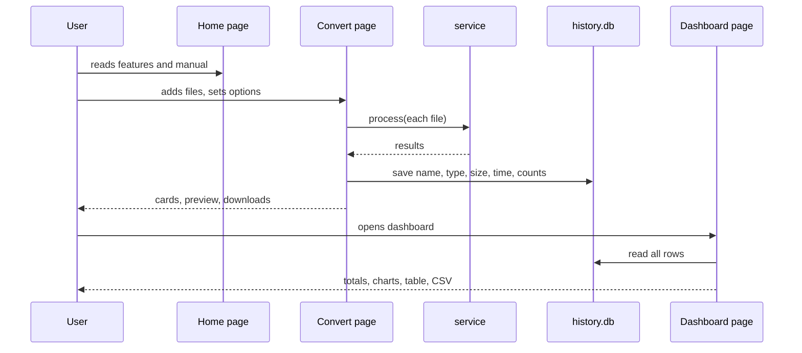

# 05 - Internal Workflow

This page follows one file through the system, step by step. Each diagram shows one stage. The algorithms behind the boxes are explained in [06 Implementation Details](06_implementation_details.md).

## 1. The whole journey

## 2. Choosing the converter

The decision uses the extension only. A PNG renamed to `.pdf` fails with "could not open PDF".

## 3. PDF workflow

## 4. Image (OCR) workflow

## 5. Data file workflow (JSON, YAML, TOML, XML)

## 6. Word and PowerPoint extras

## 7. Figures and equations in a PDF page

## 8. Token tools

## 9. Analysis workflow

## 10. Web app and history

---
Previous: [04 System Architecture](04_system_architecture.md) · Next: [06 Implementation Details](06_implementation_details.md)
