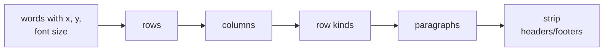

# 06 - Implementation Details

The important algorithms, with the numbers used in the code and the reasons behind them. File names point to where each idea lives. Constants can change; the code is the final source.

## 1. Token estimate (`src/convert/base.py`)

```python
def estimate_tokens(text):
    ascii_chars = sum(1 for c in text if ord(c) < 128)
    other = len(text) - ascii_chars
    return max(1, round(ascii_chars / 4 + other / 1.5))
```

- English text averages about 4 characters per token, so ASCII characters are divided by 4.
- Bangla, Arabic and CJK text splits into many more tokens, so other characters are divided by 1.5.
- It is a **planning estimate**. A real tokenizer gives different numbers for each model.

## 2. PDF layout (`src/convert/pdf.py`)

A PDF stores *where each letter is drawn*, not paragraphs. The converter rebuilds structure from geometry.



| Step | Rule | Reason |
|---|---|---|
| Rows | Two words are in the same row when their vertical centres differ by at most `0.55 x` the larger font size | Tolerates superscripts and slightly raised words |
| Spaces | A gap wider than `0.12 x` font size between words is a space | Joins letters that were drawn one by one |
| Columns | A vertical strip with almost no words, near the page middle, over enough rows, is a gutter. Left column is read first | Avoids mixing lines of two columns |
| Headings | Font size at least `body x 1.15 + 0.3`, up to 200 characters. Sizes are ranked to give `#`, `##`, `###`; short all-bold lines also count | Headings are bigger or bolder than body text |
| Lists | Lines starting with bullets or numbers; indent gives nesting | Keeps list structure |
| Code | Monospace font blocks become fenced code | Keeps spacing |
| Joining | Wrapped lines join into one paragraph; words split by a hyphen at a line end are rejoined; ligatures (fi) and soft hyphens are cleaned | Reads as normal text |
| Headers and footers | Lines in the top or bottom 8% of the page whose text (digits ignored) repeats on at least half the pages, in documents of 3+ pages; bare page numbers in 2+ pages | Removes tokens that repeat on every page |
| Scanned pages | Fewer than 20 characters on a page: render at 250 dpi, run OCR | Pages without a text layer |
| Margin stamps | Vertical text such as an arXiv stamp moves to the end of the page with a note | Keeps it out of the middle of a paragraph |

**Tables.** First, ruled tables found by pdfplumber (using lines). Second, "rule-only" tables, where horizontal rules separate rows but vertical lines are missing. A table is placed in the text at its vertical position, and its words are removed from the text flow so nothing is duplicated.

## 3. Figures and display equations (`src/convert/pdf_special.py`)

Text extraction cannot rebuild a diagram or a typeset formula, so these regions are cropped from the rendered page and saved as PNG.

**Figures**

1. Raster images of at least 40 x 30 points that are not almost the whole page.
2. Vector drawings: lines, curves and rectangles outside tables are clustered (objects closer than 12 points join). A cluster with at least 6 objects is a figure.
3. Short labels just outside the box (axis names, tick numbers) are added. Captions starting with "Figure" or "Table" stay as text.
4. A region with more than 60 words is a background, not a figure, and stays text.

**Equations**

1. Each text row is cut into segments where the gap between words is more than 1.6 x font size. This keeps two columns apart.
2. A segment is a formula when **either** at least 25% of its characters are in a maths font (names such as `cmmi`, `cmsy`, `cmex`, `stix`, `cambria math`) **or** it has two or more maths symbols (∑ ∫ ≤ ≥ Greek letters), and in both cases it has little prose (fewer than 4 words of 4+ letters). A third rule accepts one symbol plus `=` or `<`, `>` in a short prose-free segment.
3. Nearby short segments with no long words (numerator, denominator, limits, "(1)") are added to the box, up to three passes.
4. The box is cropped at 170 dpi, scaled to at most 1600 pixels wide, saved. At most 80 images per document.

The words inside each region become the image's alt text, so a text-only chat still gets them.

## 4. Word equations (`src/convert/omml.py`)

Word stores an equation as a tree of `m:` elements. Each element has a LaTeX form:

| Word element | LaTeX |
|---|---|
| `m:f` fraction | `\frac{num}{den}` (`\binom` when there is no bar) |
| `m:sSup`, `m:sSub`, `m:sSubSup` | `x^{2}`, `x_{i}`, `x_{i}^{2}` |
| `m:rad` | `\sqrt{x}` or `\sqrt[n]{x}` |
| `m:nary` | `\sum_{a}^{b} ...`, `\int ...` |
| `m:d` | `\left( ... \right)` |
| `m:m` matrix | `\begin{matrix} ... \end{matrix}` |
| Greek letters and operators | mapped by a table (`α` to `\alpha`) |
| Unknown element | the text of its children, so nothing is lost |

Inline equations become `$...$`, display equations `$$...$$`.

## 5. Image OCR (`src/convert/image.py`)

| Step | Detail | Reason |
|---|---|---|
| Orientation | EXIF rotation applied | Phone photos are often stored sideways |
| Transparency | Flatten onto white | A transparent PNG would turn black |
| Dark mode | If the mean grey level is below 110, invert | OCR expects dark text on light |
| Size | Enlarge below 1400 px, shrink above 5000 px | Tesseract works best around this range |
| Mode | Try page mode 3; if mean confidence is under 90 or few words, also try modes 6 and 4 and keep the best | Different layouts suit different modes |
| Layout | Words grouped into lines; a line is joined to the previous one only when it reaches the right edge (88% of the widest line) and does not look like a label | Prevents merging separate lines |
| Headings | Line height at least 1.45 x body height and 12 words or fewer | Larger text is a heading |
| Confidence | Mean word confidence; a note names words below 60 | Tells where to check |
| Frames | At most 20 frames of a GIF or TIFF | Keeps time bounded |

## 6. Data files (`src/convert/structured.py`)

- A list of at least 2 records is a table when the keys overlap by at least 50% and there are at most 30 columns. Each key is written once instead of once per record. This is where most tokens are saved.
- Everything else becomes `key: value` lines indented by depth, down to 12 levels; deeper content becomes compact inline JSON.
- Compact mode drops empty values and reports how many characters were removed.
- XML with entity declarations is refused (protects against entity-expansion attacks).
- Notebooks keep Markdown cells, code, and the first 40 lines of text output; embedded images are dropped.
- HTML: navigation, footers, scripts, styles and link addresses are removed.
- `json_mode="minified"` keeps exact JSON and only removes whitespace.

## 7. Compact mode and splitting (`src/convert/compact.py`)

Compact mode is idempotent (running it twice changes nothing) and never touches code blocks. It removes table padding and alignment rows, HTML comments, repeated spaces and extra blank lines.

Splitting by token budget:

```python
units = blocks of the document (very large blocks are cut further)
for unit in units:
    cost = estimate_tokens(unit) + 1
    overflow = current + cost > N and (current >= 0.25 * N or current + cost > 1.15 * N)
    new_section = unit starts with "#" and current > 0.6 * N
    if overflow or new_section:
        close the current part
```

- Parts break **before headings** once they are 60% full, so a section is not cut in the middle when avoidable.
- A part is never closed too early (25% rule), unless a single block would exceed 115%.
- Each part starts with `(part i of n)`, and a table that continues repeats its header row.
- The smallest allowed budget is 200 tokens.

## 8. Document type (`src/analyze/classify.py`)

- Formats decide first: JSON, YAML, TOML, XML, notebook, code and HTML have fixed labels; Excel and CSV are labelled financial, contact list or data by word counts.
- For text documents, each type has weighted regular-expression cues, for example `abstract` (3), `et al` (2), `related work` (2.5) for research papers; `hereinafter` (3), `whereas` (3) for contracts.
- Each cue counts at most **3 times**, so one repeated word cannot decide the result.
- Headings are added once more to the scored text.
- Best score below 4: "General document" with low confidence. Score at least 10 and at least 1.8 x the runner-up: high confidence. Otherwise medium or low.
- The matched cues are returned, so the decision can be inspected.

## 9. Summary (`src/analyze/summarize.py`)

Extractive method:

```python
sentences = split text; keep those with 6 to 70 words
score = sum(word frequency of its meaningful words) / (number of words ** 0.6)
score *= 1.35 if it is one of the first 3 sentences, 1.15 if among the next 5
keep the top 4 and print them in original order
```

- Dividing by `length ** 0.6` stops long sentences from winning only because they are long.
- Early sentences get a bonus because introductions summarise.
- Lists, tables, code and saved image links are removed before scoring.
- For Excel, CSV, data files, code, notebooks and slides, special summaries describe structure (rows, columns, keys, slides).

AI summary (optional):

1. The model sees the first 80% and last 20% of up to 12,000 characters.
2. It must answer in JSON.
3. **Safety check:** every number of 3 or more characters in the answer must appear in the document. Otherwise the answer is discarded, the extractive summary is kept and a note says so.

## 10. Service layer (`src/service.py`)

- One function, `process()`, validates the request, converts, classifies, summarises and returns a plain dictionary. The web app, CLI and API all call it.
- Image bytes travel under the private key `_assets`; `public()` removes it so the rest is JSON-safe.
- `output_files()` applies the token split; `zip_results()` builds the archive and adds `assets/` files once.
- The CLI never overwrites within one run: two inputs with the same stem become `report.md` and `report_txt.md`.

## 11. History (`src/history.py`)

- SQLite file `~/.ai_document_analyst/history.db` (or `HISTORY_DB`).
- One row per conversion: time, file name, format, type, size, pages, words, tokens, tables, figures, equations, notes count, seconds, success flag, error text.
- Document text is never stored. A test checks that a secret sentence does not appear in the file.

## 12. Design decisions

| Decision | Reason | Trade-off |
|---|---|---|
| Rules and geometry, not a trained model | Free, fast, explainable | Misses unusual layouts |
| Warnings instead of silent loss | Trust | More text in results |
| Extractive summary by default | Cannot invent facts | Less fluent than AI text |
| Equations in PDFs as images | Reliable and honest | Not LaTeX, not searchable except by alt text |
| Compact mode on by default in the web app only | Web users paste into chats | CLI and API stay exact by default |
| Extension decides the converter | Simple and predictable | A wrong extension gives an error |
| One shared service | No drift between interfaces | Interfaces cannot differ in behaviour |
| History stores only metadata | Privacy | No way to re-open past output |

---
Previous: [05 Internal Workflow](05_internal_workflow.md) · Next: [07 Installation and Setup](07_installation_and_setup.md)
