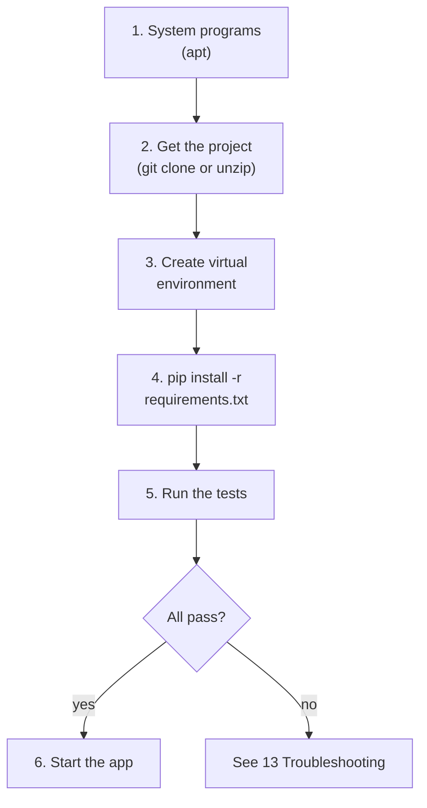

# 07 - Installation and Setup

Tested on Ubuntu (Linux). macOS and Windows steps are given but were **not tested**.

## What is needed

| Item | Needed for | Required? |
|---|---|---|
| Python 3.11 or newer | Everything | Yes |
| `python3-venv` and `pip` | Isolated package install | Yes |
| Tesseract OCR (`tesseract-ocr`) | Images and scanned PDFs | Yes, for OCR features |
| Tesseract language packs | Languages other than English | Only for those languages |
| LibreOffice (writer, calc, impress) | Old `.doc .xls .ppt .odt .rtf` files | Optional |
| Ollama or another OpenAI-compatible server | AI-written summary | Optional |
| Docker | Container run | Optional |
| Git | Cloning and pushing | Recommended |

## Install steps



### 1. System programs

```bash
sudo apt update
sudo apt install -y python3 python3-venv python3-pip tesseract-ocr git unzip
python3 --version        # 3.11 or newer
tesseract --version
```

Optional:

```bash
sudo apt install -y tesseract-ocr-ben                                         # Bangla OCR (pattern: tesseract-ocr-<code>)
sudo apt install -y python3-tk                                                # desktop window
sudo apt install -y libreoffice-writer libreoffice-calc libreoffice-impress   # old Office files
```

macOS: `brew install python tesseract` (languages: `brew install tesseract-lang`).
Windows: install Python from python.org and a Tesseract build, then add Tesseract to `PATH`.

### 2. Get the project

```bash
git clone https://github.com/Shimu-I/ai-document-analyst.git
cd ai-document-analyst
```

or, from a zip file: `unzip ai-document-analyst.zip && cd ai-document-analyst`.

### 3. Virtual environment

```bash
python3 -m venv .venv
source .venv/bin/activate         # repeat in every new terminal; the prompt shows (.venv)
```

Windows: `.venv\Scripts\activate`.

### 4. Python packages

```bash
pip install -r requirements.txt
```

Streamlit 1.36 or newer is required (the web app uses `st.navigation`).

### 5. Check

```bash
python -m unittest discover -s tests -t .      # expect: Ran 131 tests ... OK (skipped=1)
```

### 6. Start

```bash
streamlit run app/streamlit_app.py             # web app on http://localhost:8501
python app/desktop.py                          # desktop window (or: bash scripts/run_desktop.sh)
python -m src.cli data/samples/report.pdf      # command line
uvicorn api.main:app                           # API on http://localhost:8000/docs
```

## Environment configuration

All settings are optional environment variables.

| Variable | Default | Meaning |
|---|---|---|
| `OCR_LANG` | `eng` | Default OCR language(s), such as `eng+ben` |
| `MAX_UPLOAD_MB` | `50` | Upload limit for the web app and API |
| `GITHUB_REPO` | empty | `owner/name` of the repository; shows the project's last-push activity in the Home page footer |
| `HISTORY_DB` | `~/.ai_document_analyst/history.db` | Where the dashboard history is stored |
| `LLM_BASE_URL`, `LLM_MODEL`, `LLM_API_KEY` | unset | OpenAI-compatible model for the optional AI summary |
| `LLM_PROVIDER` | auto | Force `anthropic` or `openai` |
| `ANTHROPIC_API_KEY`, `ANTHROPIC_MODEL` | unset | Anthropic API for the optional summary |
| `LLM_SUMMARY_CHARS` | `12000` | How much text the model sees |
| `LLM_TIMEOUT` | `300` | Seconds to wait for the model |
| `PRICE_INPUT_PER_MTOK`, `PRICE_OUTPUT_PER_MTOK` | built-in table | Price used for the cost estimate |

Example, with a free local model:

```bash
ollama pull llama3.2                                   # any instruction-tuned model; see 'ollama list'
export LLM_BASE_URL=http://localhost:11434/v1
export LLM_MODEL=llama3.2
python -m src.cli report.pdf --llm
```

Streamlit theme and toolbar settings are in `.streamlit/config.toml`.

## Docker (optional)

```bash
docker compose up --build ui        # web app on http://localhost:8501
docker compose up --build api       # API on http://localhost:8000/docs
docker compose down
```

The image is `python:3.12-slim` plus `tesseract-ocr`. Docker was not run in the build environment.

## Updating an existing copy

A script such as `apply_update.sh` can copy new files into the project, keep backups of replaced files, and re-run the tests. After an update: `pip install -r requirements.txt` again.

## Uninstall

Delete the project folder. The history file is separate: `rm -r ~/.ai_document_analyst`.

---
Previous: [06 Implementation Details](06_implementation_details.md) · Next: [08 User Guide](08_user_guide.md)
