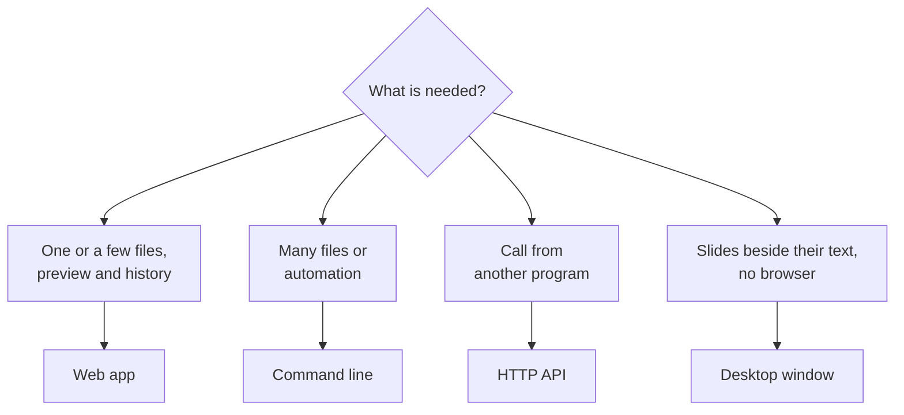
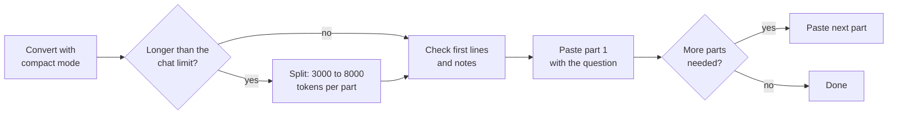

# 08 - User Guide

How to use every interface, with commands, examples and the output to expect.

## Which interface to use



## 1. Web app

Start: `streamlit run app/streamlit_app.py`, then open http://localhost:8501.

The top bar has five pages, a small **model chip** and a **Dim / Light** switch. The chip shows whether the open-source AI model used for the optional summary is running: "Open-source model · Active", "Not running" or "Not installed", or "AI model · off" when none is set (the built-in summary still works). It asks the model server named by `LLM_MODEL` and `LLM_BASE_URL` (Ollama by default) for its model list. Project activity (last push to the GitHub repository in `GITHUB_REPO`) is shown in the footer of the Home page. **Dim** gives a darker page for low light.

| Page | What it is for |
|---|---|
| **Home** | Overview, measured numbers, feature list, how it works, a short manual, supported files |
| **Convert** | The tool: add files, choose options, read results, download |
| **Dashboard** | History of every conversion, totals, charts, filters, CSV export |
| **Guide** | Options, formats, limits, fixes |
| **Docs** | The full documentation (sections 01 to 15 and the deep-dive chapters) with a section list, contents of the open section, search and previous / next buttons. Diagrams are shown as pictures |

### Convert page, step by step

1. **Files.** Drag files into the box or choose *Browse files*. Several files are allowed.
2. **Options.**

| Option | Default | Effect |
|---|---|---|
| Keep figures, diagrams and equations as images | on | Saves them as PNG files linked from the Markdown |
| Read text inside pictures (slides saved as images) | on | Runs OCR on pictures in PowerPoint, Word and PDF files; the text appears as quoted lines (`> ...`) under the picture |
| Put the summary at the top of the .md file | off | Adds type, summary and key points before the text |
| Mark page breaks in PDFs | off | Adds `<!-- page N -->` comments |
| Compact mode | on | Removes padding, comments, empty values |
| Split into parts of about N tokens | 0 (off) | Cuts long output into parts |
| Keep JSON exact (minified) | off | One-line exact JSON instead of readable tables |
| Advanced: keep repeated headers and footers | off | Stops header and footer removal |
| Advanced: force OCR | off | Reads every PDF page as a picture |
| Advanced: OCR language | `auto` | English, plus Bengali when its language pack is installed (`sudo apt install tesseract-ocr-ben`); or codes such as `eng+ben` |
| Advanced: use an AI model for the summary | off | Needs a configured model |

3. Press **Convert**. A progress bar runs; each file gets a card.
4. Read the card: type, summary, metrics, notes.
5. Download: **Download .md**, or **.md + images (.zip)** when images were saved. For several files there is one **Download everything (.zip)**.

**Preview of picture text.** Text read from a picture is shown as text only (bullets and indentation kept), without repeating the image. The switch **Show original pictures beside the text** (above the preview) puts each original picture next to its text. Pictures that have no text of their own, such as diagrams and equations, are always shown.

### Reading a result card

| Part | Meaning |
|---|---|
| Title line | Document type, format, pages, words |
| Words, tokens, tables | Counts; tokens are an estimate. The small delta compares with the raw file for text formats |
| Figures and equations | How many were saved as images |
| Time / OCR confidence | Processing time, or confidence for images |
| Summary | Extractive by default; the line under it names the method and the matched cues |
| Notes | Everything that was not converted faithfully |
| Tabs | Preview (rendered), Markdown (raw), Outline, Images |

### Dashboard page

Filters: period, document type, status. Totals: documents, processing time, words, tokens, success rate, average time, data size, tables, figures, equations. Charts: documents and time per day, by type and by format. Table of every conversion. **Export CSV** and **Clear history** are at the bottom.

## 2. Command line

```bash
python -m src.cli <file or folder> [options]
```

| Flag | Meaning |
|---|---|
| `-o, --out DIR` | Output folder (default: next to each input) |
| `--stdout` | Print Markdown instead of writing files |
| `--summary` | Put type, summary and key points at the top |
| `--compact` | Remove padding, comments, empty values |
| `--max-tokens N` | Split into parts of about N tokens (N at least 200) |
| `--json readable\|minified` | Data file style |
| `--pictures-ocr` | Read the text inside pictures with OCR (image-based slides, screenshots in Word, PDF figures) |
| `--images` | Save figures, diagrams, equations in `assets/` next to the `.md` |
| `--lang CODE` | OCR language, such as `eng`, `ben`, `eng+ben` |
| `--ocr` | Force OCR for PDFs |
| `--page-markers` | Insert page comments |
| `--keep-headers` | Keep repeated headers and footers |
| `--llm` | Use the configured AI model for the summary |

Exit codes: `0` all files converted, `1` at least one failed (others are still written), `2` nothing to convert.

### Examples with real output

```text
$ python -m src.cli data/samples/report.pdf --compact -o out/
data/samples/report.pdf  ->  out/report.md   [Business report / proposal, 229 words, ~376 tokens]

$ python -m src.cli data/samples/paper_two_column.pdf --max-tokens 1500 -o out/
... -> out/paper_two_column_part1.md   [Research paper, 1,664 words, ~945 tokens]
... -> out/paper_two_column_part2.md   [Research paper, 1,664 words, ~1,241 tokens]
... -> out/paper_two_column_part3.md   [Research paper, 1,664 words, ~418 tokens]

$ python -m src.cli paper.pdf --images -o out/
paper.pdf  ->  out/paper.md   [...]
    saved 3 image file(s) in out/assets

$ python -m src.cli nothere.pdf ; echo $?
FAILED  nothere.pdf: [Errno 2] No such file or directory: 'nothere.pdf'
1
```

More patterns:

```bash
python -m src.cli scan.png --stdout                    # OCR text in the terminal
python -m src.cli docs/ -o markdown/                   # all documents and images in a folder
python -m src.cli slides.pptx --pictures-ocr             # text from slides that are pictures
python -m src.cli data.json --json minified            # exact JSON, no whitespace
python -m src.cli note.png --lang eng+ben              # English and Bangla
```

A folder scan converts documents, spreadsheets, slides, HTML, notebooks, old Office files and images. It skips plain text, Markdown, source code and data files, because they are already text; name them directly to convert them.

## 3. HTTP API

Start: `uvicorn api.main:app`. Interactive documentation: http://localhost:8000/docs.

| Endpoint | Method | Returns |
|---|---|---|
| `/health` | GET | Status, upload limit, whether an AI model is configured |
| `/analyze` | POST | Type, summary, outline, stats (no Markdown) |
| `/convert` | POST | Everything as JSON, including `parts` |
| `/convert/download` | POST | The `.md` file, or a `.zip` for parts or images |

```bash
curl -F file=@report.pdf http://localhost:8000/analyze
curl -F file=@data.json -F compact=true -o data.md http://localhost:8000/convert/download
curl -F file=@book.pdf -F max_tokens=3000 -o book_parts.zip http://localhost:8000/convert/download
curl -F file=@paper.pdf -F images=true -o paper.zip http://localhost:8000/convert/download
```

Form fields: `picture_ocr`, `compact`, `json_mode`, `ocr_lang`, `max_tokens`, `images`, `page_markers`, `keep_headers`, `force_ocr`, `use_llm`, and `include_summary` for downloads.
Errors come as JSON `{"detail": "..."}` with status 400, 413, 415 or 422. There is **no login and no rate limit**; use it only on a trusted network.

## 4. Desktop window

Start: `python app/desktop.py` (or `bash scripts/run_desktop.sh`). It needs Tkinter (`sudo apt install python3-tk`), Tesseract, and LibreOffice for PowerPoint and Word files.

| Part | What it does |
|---|---|
| **Open…** (Ctrl+O) | PDF, PowerPoint, Word or image. Reading runs in the background with a progress bar |
| **Language** | `auto` (English, plus Bengali when installed), `eng`, `ben`, `eng+ben` |
| Left: filmstrip | One thumbnail per slide or page; click one to open it. Alt+Left and Alt+Right also move |
| Middle: original | The slide as it is. **Show original** hides or shows this pane |
| Right: text | The text in the slide's layout (bullets, nesting, headings). It can be edited; corrections are kept per slide |
| **Linked reading** | Click or move the cursor to a line of text: its place on the slide gets a frame. Click on the slide: the matching line is selected |
| **Save .md** (Ctrl+S) / **Copy all** | All slides, each under `## Slide N`, with the corrections applied |
| **Dim / Light** | Colour mode |
| Status bar | Words, estimated tokens, OCR confidence or "text layer", "edited" mark; the total for the whole file at the top right |

Expected result for a slide that is a picture with five bullets: the five lines as a Markdown list, the sub-point nested one level, and a frame on the slide for each line clicked. A page that has real text (not a picture) is read from its text layer, without OCR.

## 5. What each format gives

See the table in [02 Features](02_features_and_functionalities.md#supported-formats-and-what-comes-out).

## 6. Using the result in an AI chat



Tips:

- For images that are mostly text, paste the OCR text instead of the picture. The card shows the cost of the image for comparison.
- Attach an image file only when the picture itself matters. Its alt text and any LaTeX are already in the Markdown.
- Check names, amounts and dates from OCR against the original.
- Keep the `.md` files: they are plain text and easy to search.

## 7. Google Docs, Sheets and Slides

Shortcut files (`.gsheet`, `.gdoc`, `.gslides`) only contain a link. Download from Google first:

| Google file | Download as |
|---|---|
| Sheets | `.xlsx` (or `.csv` for one sheet) |
| Docs | `.docx` or `.pdf` |
| Slides | `.pptx` or `.pdf` |

---
Previous: [07 Installation](07_installation_and_setup.md) · Next: [09 Reproducibility Guide](09_reproducibility_guide.md)
