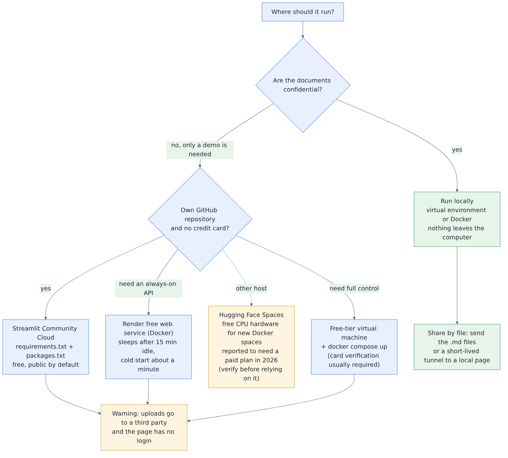

# 09 - Deployment with free resources

> **Status of this chapter.** Nothing here was deployed from the environment where the project was built. The steps follow the
> hosting providers' public documentation (checked in November 2026) and the project's own files. Free tiers change often, so
> each section says what to verify. Treat every deployment as an experiment until the checklist in section 9 passes.



*Figure 1. Choosing where to run the tool.*

## 1. Pick by the documents, not by the hosting

| Question | Consequence |
|---|---|
| Are the documents confidential (contracts, personal data, unpublished work)? | **Run locally.** A hosted page means uploading the files to a third party, and the page has no login |
| Is a public demo for a portfolio enough? | Use **synthetic or public documents only**, and a hosted page is acceptable |
| Does another program need an API? | A container on a small server; the API has no authentication, so put it behind a proxy with a password |

| Option | Cost | Credit card | Sleeps when idle | Tesseract OCR | Fit |
|---|---|---|---|---|---|
| A. Local (venv or Docker) | free | no | no | yes | Real work; private documents |
| B. Streamlit Community Cloud | free | no | yes (wakes on a visit) | yes, through `packages.txt` | Portfolio demo of the web page |
| C. Render free web service | free | verify | yes, after 15 minutes idle | yes, in the Docker image | Demo or small API |
| D. Hugging Face Spaces | **reported not free** for new Docker spaces | - | - | - | Check current terms before planning on it |
| E. Always-free virtual machine at a cloud provider | free tier | usually yes (verification) | no | yes | Always-on API and page |
| F. Temporary tunnel to a local page | free tier of the tunnel tool | verify | only while the computer runs | yes | Showing the page to someone for an hour |

## 2. Option A - run locally

### Virtual environment

Follow [chapter 06, section 1](06_user_manual.md#1-install-in-five-minutes), then `streamlit run app/streamlit_app.py`.

### Docker (optional)

Requires Docker Engine and the Compose plugin.

```bash
docker compose up --build ui          # web page at http://localhost:8501
docker compose up --build api         # API at http://localhost:8000/docs
docker compose up --build             # both
docker compose down                   # stop and remove containers
```

What the files do: `Dockerfile` builds from `python:3.12-slim`, installs `tesseract-ocr`, installs `requirements.txt` and copies the project; the default
command starts the API. `docker-compose.yml` defines `api` and `ui` from that one image (`ui` overrides the command to start Streamlit) and passes the optional AI
settings through. Old `.doc/.xls/.ppt` files need LibreOffice in the image: add `libreoffice-writer libreoffice-calc libreoffice-impress` to the `apt-get install` line
(this makes the image several hundred megabytes larger).

Docker was **not run** where the project was built. If `docker compose up --build` fails, the build log shows which step; the usual causes are no network during
`pip install` and Docker not running.

## 3. Option B - Streamlit Community Cloud

Streamlit's own free hosting for public GitHub repositories.

### Preparation

1. The project is in a GitHub repository (public, unless the account is allowed private apps).
2. `requirements.txt` is in the repository root (present). The platform installs Python packages from it.
3. `packages.txt` is in the repository root with one Debian package per line (present; contains `tesseract-ocr`). The platform installs these with apt before the app starts.
4. The app file is `app/streamlit_app.py`. It adds the project root to `sys.path` itself, so it runs from the repository root.
5. No secrets in the repository. Optional AI keys go into the platform's *Secrets* setting, never into files.

### Deploy

1. Sign in at share.streamlit.io with GitHub and authorise access to the repository.
2. **Create app** (or *New app*), choose the repository, the branch (`main`) and the main file path `app/streamlit_app.py`.
3. Open **Advanced settings**: choose a Python version (3.11 or newer; 3.12 matches the Docker image) and paste optional secrets.
4. **Deploy**. The first build installs every package and can take several minutes. The build log is shown live.

### Things to know

| Topic | Detail |
|---|---|
| Build failures | `requirements.txt` includes test-only packages (pytest, reportlab, pypdf, httpx). They install fine but slow the build. A slimmer file can be placed next to the app (`app/requirements.txt`), because a dependency file in the entry-point folder takes precedence over the root one: `pdfplumber python-docx openpyxl python-pptx pytesseract Pillow beautifulsoup4 PyYAML requests` |
| apt problems | Community forum threads in 2026 report occasional failures of apt-based installs for apps with `packages.txt`. When the build log shows an apt error, search the forum for the exact message before changing the project |
| Public by default | The app address is reachable by anyone with the link; sharing settings are in the app's menu. Uploaded files are processed on the platform's servers |
| Resources | Free apps have limited memory and CPU. Large PDFs and 25-frame GIFs may be slow or run out of memory; lower `MAX_UPLOAD_MB` through secrets/environment settings |
| Sleeping | Apps without visitors are put to sleep and wake on the next visit (a delay of some seconds to a minute) |
| LibreOffice | Not installed by default. Adding `libreoffice-writer` and friends to `packages.txt` is possible but makes the build heavy and was not tested. Without it, old Office files give a clear error asking for a modern format |

### Optional: password for the page (untested sketch)

Put `APP_PASSWORD = "choose-a-long-passphrase"` into the platform's *Secrets*, then add near the top of `app/streamlit_app.py`, before the uploader:

```python
import hmac
import streamlit as st

def require_password() -> None:
    try:
        expected = st.secrets.get("APP_PASSWORD")
    except Exception:                    # no secrets file when running locally
        expected = None
    if not expected:
        return                           # no password configured: the page stays open
    entered = st.text_input("Password", type="password")
    if not entered:
        st.stop()
    if not hmac.compare_digest(entered, expected):
        st.error("Wrong password")
        st.stop()

require_password()
```

`hmac.compare_digest` compares in constant time. This protects the page from casual visitors; it is not a substitute for real access control.

## 4. Option C - Render free web service (Docker)

Render's free web services run a Docker image from a GitHub repository. From Render's free-tier documentation: instances **spin down after 15 minutes without inbound traffic** and need
about a minute to start again; there is a monthly allowance of free instance hours; the local disk is not persistent. Memory limits and Docker-specific rules for the free
tier were not confirmed on the page consulted, so check the "Free" and "Docker" documentation pages before relying on this.

Sketch (unverified):

1. New > Web Service > connect the GitHub repository; environment: Docker; instance type: Free.
2. The image's default command starts the API on port 8000. To serve the web page instead, set the start command to
   `streamlit run app/streamlit_app.py --server.address 0.0.0.0 --server.port $PORT` (Render passes the port to listen on in `PORT`; the API variant would
   likewise need `--port $PORT`).
3. Set environment variables in the dashboard (`MAX_UPLOAD_MB`, optional AI settings).
4. After the first request wakes the service, test with the checklist in section 9.

## 5. Option D - Hugging Face Spaces

Spaces used to be the standard free home for Streamlit and Docker demos. According to Hugging Face's current documentation, creating a new Space that runs on compute (Docker or
Gradio) requires a paid plan, while Static Spaces (plain HTML/JavaScript) remain free, and community discussions in 2026 dispute these changes. This project needs Python,
Tesseract and file uploads, so a Static Space cannot host it. Check the Spaces documentation for the rules that apply at the time of deployment before planning on it.

## 6. Option E - an always-free virtual machine

Several cloud providers offer an always-free small virtual machine. Typical requirements: an account with a payment card for identity verification, resource limits, and terms that change.
Verify the current offer before starting. On a plain Ubuntu machine:

```bash
sudo apt update && sudo apt install -y docker.io docker-compose-v2 git
git clone https://github.com/<GITHUB-USERNAME>/ai-document-analyst.git && cd ai-document-analyst
sudo docker compose up -d --build ui
```

Then open port 8501 in the provider's firewall/security group. For anything beyond a private test, put a reverse proxy in front (Caddy or nginx) to provide HTTPS and a password,
because Streamlit and the API have no login of their own.

## 7. Option F - temporary sharing from a local computer

Run the page locally, then expose it with a tunnelling tool (for example Cloudflare's quick tunnels or ngrok's free plan; check current terms). The page is reachable while the
computer and the tunnel run. Documents still never reach a third-party *host*, but the tunnel provider relays the traffic. Use a password (section 3) before sharing a link.

## 8. Security and privacy checklist for any public deployment

- [ ] Only synthetic, public or consent-covered documents are uploaded; the page says so.
- [ ] A password or other access control is in front of the page and the API.
- [ ] `MAX_UPLOAD_MB` is set to a small value (for example 10) to limit memory use and abuse.
- [ ] No API keys, tokens or `.env` files in the repository; secrets live in the platform's secret store.
- [ ] The AI summary is off unless the provider's data terms are acceptable.
- [ ] A note on the page explains where files are processed and that nothing is stored by the application (conversion happens in memory; Streamlit keeps results only for the active session).
- [ ] The repository contains no real client documents among the samples.

## 9. Post-deployment checklist

| # | Test | Expected |
|---|---|---|
| 1 | Open the address | The page loads with the sidebar |
| 2 | Upload `data/samples/report.pdf` | Type *Business report*, headings as `#`, download works |
| 3 | Upload `data/samples/paper_two_column.pdf` with *split* = 1500 | Three parts and a `.zip` |
| 4 | Upload a PNG with text (`scripts/make_image_samples.py` makes some) | Text and an OCR confidence. A "tesseract is not installed" error means `packages.txt` was not applied |
| 5 | Upload `data/samples/scanned.pdf` | OCR text and a warning that OCR was used |
| 6 | Upload a `.json` file with *compact* on | A table and fewer tokens than the file |
| 7 | Upload a file named `x.gsheet` | The "download as .xlsx" instruction |
| 8 | Upload an empty file | A clear error, not a crash |
| 9 | Upload a file above `MAX_UPLOAD_MB` | A size error (the platform may enforce its own, lower limit first) |
| 10 | Reload and convert twice | Same output both times; downloads still work after the first click |

Record the result of each test in the repository (a short table in the README or an issue). A deployment link without a record of what was tested proves little.
