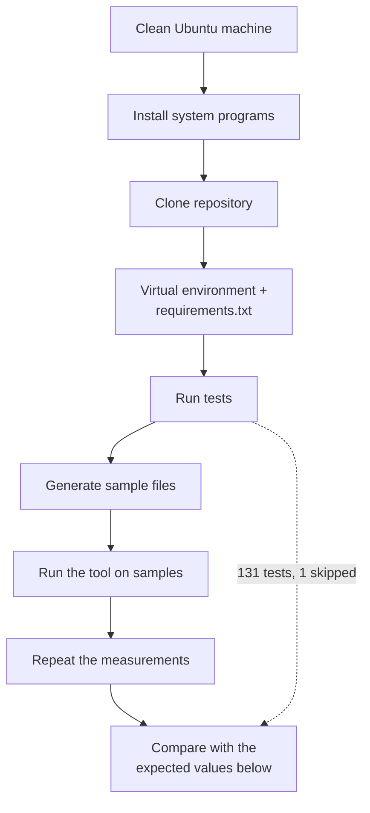

# 09 - Reproducibility Guide

Exact steps to rebuild the project state and repeat every measured result from a clean computer. Two goals:

- **Run it:** get the same behaviour as the repository.
- **Rebuild it:** write the code again, phase by phase. That path is in [deep dive: build from scratch](deep_dive/build_from_scratch.md).

## The reproduction path



## Step 1 - Clean environment

```bash
sudo apt update
sudo apt install -y python3 python3-venv python3-pip tesseract-ocr git
git clone https://github.com/Shimu-I/ai-document-analyst.git
cd ai-document-analyst
python3 -m venv .venv
source .venv/bin/activate
pip install -r requirements.txt
```

Versions used while building: Python 3.13, Tesseract 5.x, Ubuntu Linux. Newer versions normally work; small differences in OCR confidence are possible between Tesseract versions.

## Step 2 - Tests

```bash
python -m unittest discover -s tests -t .       # Ran 131 tests ... OK (skipped=1)
python -m pytest -q                             # 131 passed, 1 skipped
python scripts/corner_cases.py                  # 49 passed, 0 failed, 0 skipped
```

The one skipped item is the API test class, skipped when FastAPI or httpx is missing. With `pip install -r requirements.txt` completed, it runs. (In the build environment those packages could not be installed, so the API endpoints were never exercised by tests there.)

## Step 3 - Sample files

| Command | Creates |
|---|---|
| `python scripts/make_samples.py` | PDF, DOCX, XLSX, PPTX samples and expected-content files in `data/samples/` (already in the repository) |
| `python scripts/make_latex_sample.py` | A LaTeX-style PDF sample; needs `pdflatex` (already in the repository) |
| `python scripts/make_image_samples.py demo/in` | Images: clean, dark, transparent, photo-like, small |
| `python scripts/make_data_samples.py demo/in` | JSON, JSONL, YAML, TOML, XML, HTML, notebook, code, `.gsheet` |

```bash
mkdir -p demo/in demo/out
python scripts/make_image_samples.py demo/in
python scripts/make_data_samples.py demo/in
```

## Step 4 - Reproduce each result

### 4.1 Token numbers for the JSON example

```bash
python - <<'EOF'
from src import service
data = open("demo/in/users.json", "rb").read()
for label, kw in [("readable", {}), ("readable + compact", {"compact": True}),
                  ("minified", {"json_mode": "minified"})]:
    r = service.process(data, "users.json", **kw)
    print(label, r["stats"]["estimated_tokens"], "raw:", r["stats"]["source_tokens"])
EOF
```

Expected: readable **822**, readable + compact **716**, minified **1416**, raw indented file **2600** (estimated tokens). Against minified: 822 is -42%, 716 is -49%.

### 4.2 Fidelity against markitdown

```bash
pip install markitdown                 # optional baseline, not a project dependency
python scripts/evaluate_fidelity.py    # prints the table; rewrites reports/fidelity.json
```

Expected (this tool / markitdown): reading order on the three sample PDFs **1.000 / 0.786**, **1.000 / 0.929**, **1.000 / 0.516**; headings recovered 6/6, 8/8, 8/8 against 0/6, 0/8, 0/8; scanned sample word recall **0.991** (markitdown has no OCR). The full table is in [10 Testing and Evaluation](10_testing_and_evaluation.md).

### 4.3 Figures and equations

```bash
python scripts/make_latex_sample.py          # optional
python -m src.cli data/samples/paper_latex.pdf --images -o demo/out
ls demo/out/assets                           # PNG files for the equation(s)
```

### 4.4 Split by token budget

```bash
python -m src.cli data/samples/paper_two_column.pdf --max-tokens 1500 -o demo/out
```

Expected: three parts of about 945, 1241 and 418 estimated tokens, each starting with `(part i of 3)`.

### 4.5 OCR

```bash
python -m src.cli demo/in/clean.png --stdout
```

Expected: the text of the picture with list lines kept. Confidence is printed in the web app and API stats.

### 4.6 Charts and diagrams in the documentation

```bash
pip install matplotlib
python scripts/make_figures.py              # docs/assets/tokens_json.png, fidelity.png
```

The Mermaid diagrams in `docs/*.md` render on GitHub with no extra step. To turn one into an image: `npm i -g @mermaid-js/mermaid-cli`, then `mmdc -i diagram.mmd -o diagram.png -s 2 -b white`. See `docs/assets/README.md`.

## Step 5 - The web app and API

```bash
streamlit run app/streamlit_app.py        # open http://localhost:8501
uvicorn api.main:app                      # open http://localhost:8000/docs
```

Check list after starting the web app:

| # | Action | Expected |
|---|---|---|
| 1 | Open the address | Home page with a top bar, no sidebar |
| 2 | Convert `data/samples/report.pdf` | Type "Business report / proposal", download works |
| 3 | Convert `data/samples/paper_latex.pdf` with images on | At least one equation image in the *Images* tab |
| 4 | Convert an empty file | A clear error, not a crash |
| 5 | Open Dashboard | The rows from steps 2 to 4 |
| 6 | Export CSV | A file with those rows |

The web app and API were **not run** in the build environment (packages could not be installed there). The pages were exercised with a stand-in for Streamlit only. Run this check list once on a real install.

## Step 6 - Rebuild from scratch (learning path)

```mermaid
flowchart LR
    P0["Phase 0<br/>setup"] --> P1["1 core types"] --> P2["2 dispatch, text, CSV"] --> P3["3 Office files"]
    P3 --> P4["4 PDF"] --> P5["5 OCR"] --> P6["6 data files"] --> P7["7 compact, split"]
    P7 --> P8["8 analysis"] --> P9["9 service"] --> P10["10 CLI"] --> P11["11 API, UI"]
    P11 --> P12["12 tests, evaluation"] --> P13["13 Docker, deploy"] --> P14["14 docs, Git"]
```



Each phase in [build from scratch](deep_dive/build_from_scratch.md) has a **Check** (a command with expected output), **Try to break it** tasks, and a commit message.

## What may differ between machines

| Item | Why |
|---|---|
| OCR confidence and text | Tesseract version and language data |
| Processing seconds | CPU speed |
| Token numbers | None: the estimate is deterministic |
| PDF samples made by `pdflatex` | Fonts and LaTeX version change glyph names |
| History timestamps | Local clock |

## Reproducibility limits

- Real-world accuracy cannot be reproduced from synthetic samples.
- Savings against chatbot file readers were never measured, so there is nothing to reproduce for that claim.

---
Previous: [08 User Guide](08_user_guide.md) · Next: [10 Testing and Evaluation](10_testing_and_evaluation.md)
