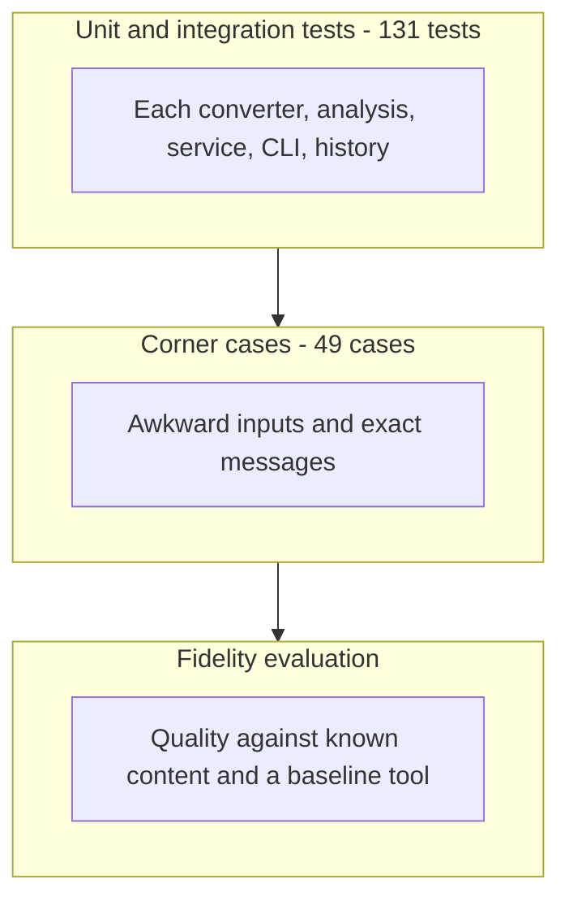
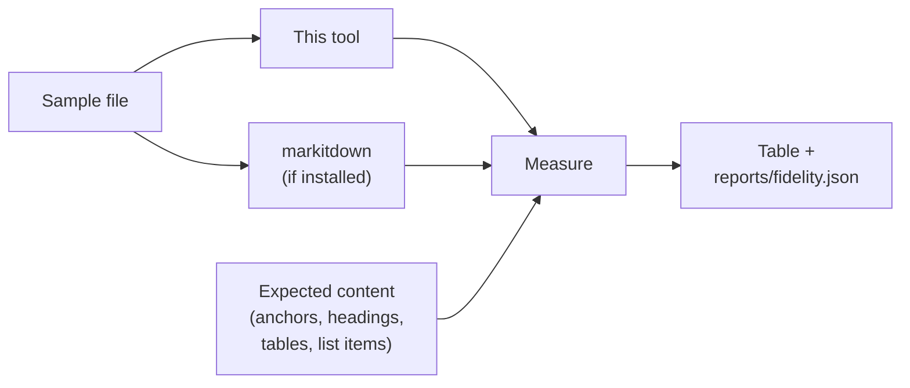
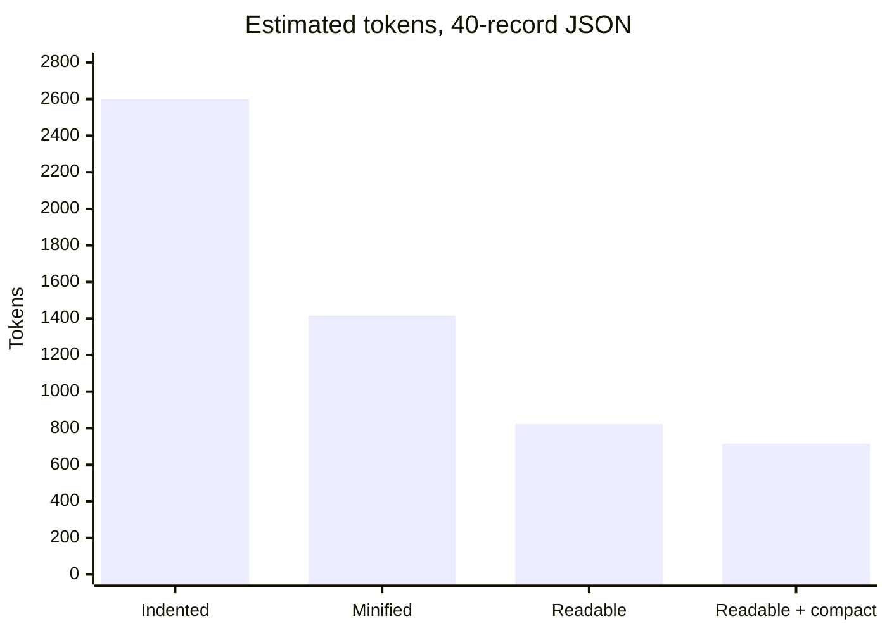

# 10 - Testing and Evaluation

Three kinds of checks protect the project:

## 1. Unit and integration tests

Run: `python -m unittest discover -s tests -t .` or `python -m pytest -q`. Result: **131 tests run, all pass, 1 skipped** (the API test class is skipped when FastAPI or httpx is not installed).

| File | Tests | What it covers |
|---|---:|---|
| `test_convert_pdf.py` | 12 | Headings, paragraphs, lists, tables, two columns, headers and footers, scanned pages, encrypted files |
| `test_convert_office.py` | 11 | DOCX, XLSX, PPTX, CSV; merged cells, hidden sheets, formulas, encodings |
| `test_analyze.py` | 9 | Document type scoring, extractive summary, outline, AI summary number check |
| `test_llm_clients.py` | 9 | Optional AI clients with stub servers, provider choice, cost estimate |
| `test_formats_and_tokens.py` | 43 | Images (OCR, dark, transparent), JSON, YAML, TOML, XML, HTML, notebooks, code, Google files, compact mode, splitting, token estimate, service, CLI |
| `test_service_cli.py` | 6 | Service error codes, zip, CLI exit codes, API (skipped without FastAPI) |
| `test_desktop_smoke.py` | 3 | Desktop window code run against a stand-in for Tkinter: loading, linked clicks, editing, theme, saving, errors |
| `test_picture_ocr.py` | 28 | Text from pictures in PPTX, DOCX and PDF (off by default, icons skipped, image link kept), project status chip rules, preview blocks, upload checks, model status, document list, contents, links, diagrams and search, slide reading (English and Bengali), desktop state and geometry |
| `test_assets_and_history.py` | 11 | PDF figures and equations as images, Word equations to LaTeX, Word and PowerPoint pictures, zip with `assets/`, CLI `--images`, history database, summary ignores image links |

Test method:

- Test files are **generated by code** (reportlab, python-docx, openpyxl, python-pptx, Pillow), so the repository holds no private documents and every case is explicit.
- Each test checks one behaviour and the exact text or number expected.
- Tests that need Tesseract, LibreOffice or a font skip themselves when it is missing, and are never counted as passes.
- A test checks that history never stores document text.

## 2. Corner cases (49)

`python scripts/corner_cases.py` runs 49 awkward inputs in groups: Input, Text, Office, PDF, Data, Image, Tokens, CLI. It prints a table, exits with 1 on any difference, and prints `SKIP` for cases that need a missing program. Last run: **49 passed, 0 failed, 0 skipped**. The cases and their exact messages are in [deep dive: corner cases](deep_dive/corner_cases.md).

## 3. Fidelity evaluation

`python scripts/evaluate_fidelity.py` compares the Markdown with the known content of each sample (`data/samples/expected/*.json`) and, when installed, with Microsoft `markitdown`.

Metrics:

| Metric | Meaning |
|---|---|
| Recall | Share of the source's words found in the output (missing text) |
| Precision | Share of output words that belong to the source (junk, duplicates) |
| Order | Longest in-order share of paragraph anchors (reading order, for columns) |
| Headings | Expected headings that appear as `#` lines |
| Tables | Expected tables whose cells appear in order inside one Markdown table |
| Lists | Expected list items that appear as list lines |
| Tokens | Estimated tokens of the output |

### Results (this tool / markitdown)

| File | Recall | Order | Headings | Tables | Lists |
|---|---|---|---|---|---|
| report.pdf | 1.000 / 0.986 | 1.000 / 0.786 | 6/6 / 0/6 | 1/1 / 0/1 | 6/6 / 3/6 |
| report.docx | 1.000 / 1.000 | 1.000 / 1.000 | 6/6 / 5/6 | 1/1 / 1/1 | 6/6 / 6/6 |
| paper_two_column.pdf | 1.000 / 0.998 | 1.000 / 0.929 | 8/8 / 0/8 | n/a | n/a |
| paper_two_column.docx | 1.000 / 1.000 | 1.000 / 1.000 | 8/8 / 7/8 | n/a | n/a |
| paper_latex.pdf | 0.999 / 0.929 | 1.000 / 0.516 | 8/8 / 0/8 | 1/1 / 0/1 | 6/6 / 2/6 |
| budget.xlsx | 1.000 / 1.000 | 1.000 / 1.000 | 2/2 / 2/2 | 3/3 / 3/3 | n/a |
| deck.pptx | 1.000 / 1.000 | 1.000 / 1.000 | n/a | 1/1 / 1/1 | 3/3 / 0/3 |
| scanned.pdf | 0.991 / 0.000 | 0.978 / 0.000 | n/a | n/a | n/a |

Image samples (OCR) are checked by tests, not by this table.

### How to read the results

- **Where the tool wins:** PDF reading order, headings and lists, scanned pages (markitdown has no OCR), and a PowerPoint list.
- **Near tie:** Word files. Both keep all words in order; only heading counts differ by one or two.
- **Honest caveats:**
  1. The samples are small and **generated**. The rules were tuned on them, so real documents will score lower.
  2. Both tools were run with default settings only.
  3. Reading order is measured with paragraph anchors, which favour correct column handling.
  4. Savings compared with a chatbot's own reader were not measured.

## 4. Token measurements

One generated 40-record JSON file (estimated tokens):

| Form | Tokens | Against minified |
|---|---:|---|
| Indented JSON (raw file) | 2600 | n/a |
| Minified JSON | 1416 | baseline |
| Readable tables | 822 | -42% |
| Readable tables + compact | 716 | -49% |

Savings depend heavily on the data: records with long text values save much less than records with short repeated keys.

## 5. Validation of claims

| Claim | How it is checked |
|---|---|
| "No text is lost" | Word recall on the sample set |
| "Reading order is right" | Order metric; unit test for two columns |
| "Summaries cannot invent numbers" | Test with an AI reply that contains a wrong number |
| "Nothing is stored about document text" | History test |
| "Errors are clear" | Corner-case messages checked exactly |
| "Compact mode is safe" | Test that compact output keeps all cell values and code unchanged; idempotence test |

## 6. What was not tested

- Streamlit pages in a browser, FastAPI server and Docker were not run in the build environment (the packages could not be installed there). Page scripts were run against a stand-in for Streamlit only.
- Windows and macOS.
- Real, large or messy documents; right-to-left PDFs; password-protected Office files.
- OCR on handwriting and on photographs.
- Equation and figure detection beyond the generated samples and one LaTeX-made PDF.

---
Previous: [09 Reproducibility Guide](09_reproducibility_guide.md) · Next: [11 Limitations and Known Issues](11_limitations_and_known_issues.md)
