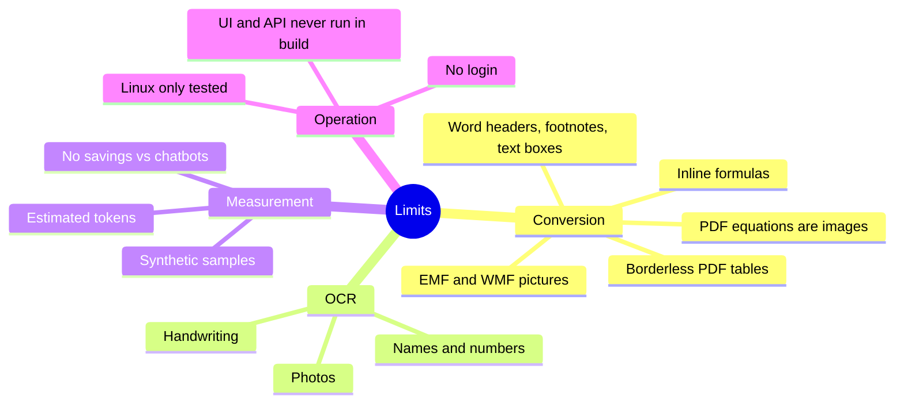

# 11 - Limitations and Known Issues

Honest list of what the tool cannot do, where it fails, and what is still open.

## 1. Technical limits

| Area | Limit | Effect |
|---|---|---|
| PDF equations | Saved as images with surrounding words, not turned into LaTeX | An AI chat can read the text around them, but not the formula itself. Word equations do become LaTeX. |
| PDF inline formulas | Formulas inside a sentence stay as plain text fragments | Symbols can be split or reordered |
| PDF tables | Tables without ruling lines may come out as plain text | Columns can run together |
| Figures | Detected from images and clusters of drawn shapes; never described | Only alt text from words inside the box |
| Pictures in EMF/WMF | Not converted to PNG | A warning is shown |
| Word files | Headers, footers, footnotes, text boxes are not included | A warning is shown |
| OCR | Can misread names, numbers, small print; handwriting and photos work poorly | Confidence and doubtful words are reported |
| Compact-mode tables | The separator row is removed to save tokens | Chat tools read them fine; some Markdown viewers show them as plain text |
| Token numbers | An estimate (ASCII characters / 4, others / 1.5) | Real counts differ by model |
| Size | Upload limit 50 MB by default (`MAX_UPLOAD_MB`) | Larger files are refused with code 413 |
| Text in pictures | OCR on pictures is slower, limited to 60 pictures per document, skips pictures under 90 px and low-confidence results | Photos, charts and icons give no text; slide text may contain OCR errors |
| Model chip | Only checks that the model server answers and lists the model; does not run a test summary | A running server with a broken model still shows Active |
| Dim mode | Streamlit's own widgets take colours from the theme file, so a few areas may stay light | Cosmetic only; not checked in a real browser |
| Desktop window | Written and tested only against a stand-in for Tkinter; never opened in a real window by the build process | Layout, colours and sizes are unchecked; first real run may show small problems |
| Slide reading | Needs LibreOffice for PowerPoint and Word; reads at most 80 slides; links between text and slide assume one text line per detected line | Edited text with a different line count falls back to the original lines for linking |
| Bengali | Needs the `tesseract-ocr-ben` pack; checked only on generated text in one font | Real Bengali slides, conjunct letters and handwriting may give errors |
| Page assets | At most 80 images per document | Extra ones are skipped and counted |
| Dashboard | Stores processing time, not document text | Time includes conversion only |

## 2. Failure cases

| Input | What happens |
|---|---|
| Password-protected PDF | Clear error (422) |
| Corrupt file | Clear error (422) |
| Empty file | Error 400 |
| Unknown extension | Error 415 |
| Image without text | Warning that no text was found |
| Very deep or huge data file | Depth is capped at 12; very large lists become tables only when keys match |
| Google shortcut files | Contain only a link; a message explains how to download a real file |

## 3. Open issues

- No known crash bugs. Unknown ones are likely on real documents, because testing used generated files.
- Equation detection is rule-based (maths fonts and symbols) and was checked only on generated samples and one LaTeX PDF.
- Right-to-left scripts and complex layouts such as magazines are untested.

## 4. Constraints of the project

- **Free only.** No paid API is needed; the optional AI summary uses a local model or a key the person already has.
- **Synthetic evaluation.** Rules were tuned on the sample files; real scores will be lower.
- **No measured savings against chatbots.** The token comparison covers the tool's own output forms only.
- **No login or rate limit** on the web app or the API. Not meant for public exposure as it is.
- **Linux only** was tested.
- **Never run in the build environment:** Streamlit, FastAPI and Docker (packages could not be installed there). The page scripts were run against a stand-in, and the API test class is skipped when FastAPI is missing. A first real run may reveal small issues.
- **Screenshots** in the documentation are renderings of the page design, not captures from a running Streamlit app.

---
Previous: [10 Testing and Evaluation](10_testing_and_evaluation.md) · Next: [12 Future Improvements](12_future_improvements.md)
