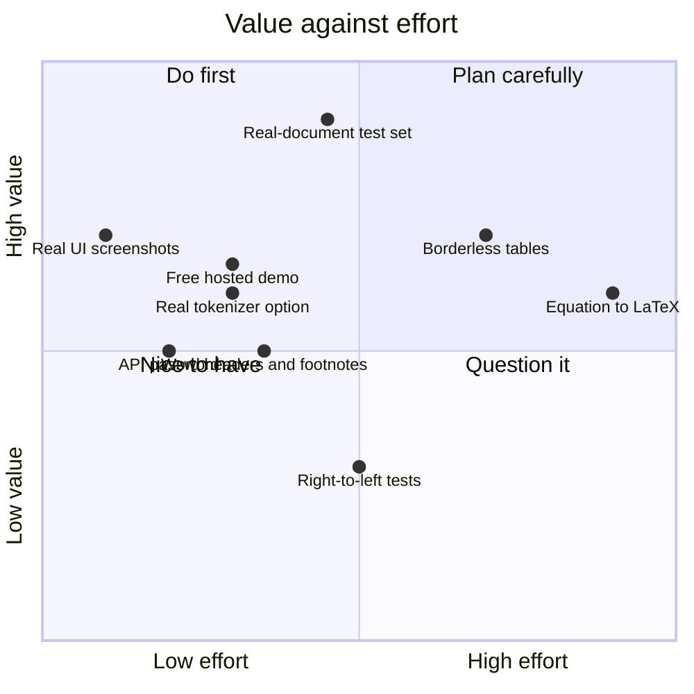

# 12 - Future Improvements

Ideas ordered by value for the effort. Each one removes a limit from [11](11_limitations_and_known_issues.md).

| # | Improvement | Why | Rough approach |
|---|---|---|---|
| 1 | Run the web app and API for real; take real screenshots | Closes the biggest honesty gap | Follow the check list in [09](09_reproducibility_guide.md) |
| 2 | Real-document evaluation set | Replaces tuned samples with honest scores | Collect public documents, write expected anchors |
| 3 | Free hosted demo | A link to show | Streamlit Community Cloud (`packages.txt` exists); see [deep dive: deployment](deep_dive/deployment_free.md) |
| 4 | Real tokenizer option | Exact counts for a chosen model | Optional `tiktoken` or similar behind a flag |
| 5 | Borderless table detection | Fewer broken columns | Column alignment of words across rows |
| 6 | Word headers, footers, footnotes, text boxes | Less lost content | Read the extra XML parts |
| 7 | API key or password | Safe sharing | Header token check in `api/main.py` |
| 8 | PDF equations to LaTeX | Chat tools could read formulas | Optional free model (for example a local formula recogniser) |
| 9 | Right-to-left and more OCR languages in tests | Wider coverage | Add samples and language data |
| 10 | Windows and macOS test runs | Wider coverage | CI matrix |
| 11 | CI on every push | Keeps the 131 tests honest | GitHub Actions running the test commands |
| 12 | Drag and drop of files into the desktop window | Faster opening | Optional `tkinterdnd2` |
| 13 | Package the desktop window as a single program | Run without Python knowledge | PyInstaller |
| 14 | Measure savings against chatbot readers | Turns a claim into a number | Same file through a chat tool and this tool, count tokens |

---
Previous: [11 Limitations and Known Issues](11_limitations_and_known_issues.md) · Next: [13 Troubleshooting](13_troubleshooting.md)
