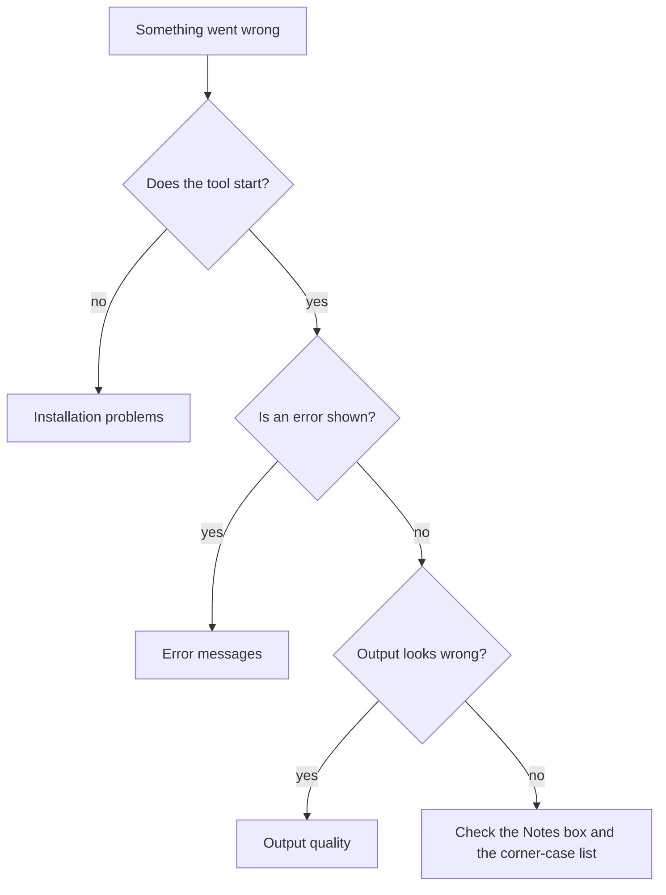

# 13 - Troubleshooting

Common errors, their causes and fixes. Start with the decision tree.

## 1. Installation

| Symptom | Cause | Fix |
|---|---|---|
| `python: command not found` | Ubuntu provides `python3` only | Use `python3` outside a virtual environment; inside an activated one `python` works |
| `error: externally-managed-environment` | `pip install` outside a venv | `python3 -m venv .venv && source .venv/bin/activate`, then `pip install -r requirements.txt` |
| `ensurepip is not available` | `python3-venv` missing | `sudo apt install python3-venv` |
| `source: .venv/bin/activate: No such file` | Venv not created or wrong folder | Run `python3 -m venv .venv` in the project folder |
| `ModuleNotFoundError: No module named 'src'` | Wrong folder, or run as a file | `cd` to the project root; use `python -m src.cli ...` |
| `ModuleNotFoundError: pdfplumber` (or another) | Venv not active or packages missing | Activate the venv; `pip install -r requirements.txt` |
| `TesseractNotFoundError` | OCR program missing | `sudo apt install tesseract-ocr` |
| `OCR language 'ben' is not installed` | Language pack missing | `sudo apt install tesseract-ocr-ben`; list with `tesseract --list-langs` |
| `ModuleNotFoundError: No module named 'tkinter'` | Tkinter not installed | `sudo apt install python3-tk` |
| `Cannot open a window: no display` | No screen (server or SSH session) | Use the web app or command line instead |
| Desktop window: `slides and Word files need LibreOffice` | LibreOffice missing | `sudo apt install libreoffice-impress libreoffice-writer`, or export the file as PDF |
| Desktop window: Bengali text missing | Language pack missing | `sudo apt install tesseract-ocr-ben`, then language `auto` or `eng+ben` |
| `streamlit: command not found` | Venv not active | Activate it, or `python -m streamlit run app/streamlit_app.py` |
| Pages missing or `st.navigation` error | Old Streamlit | `pip install -U "streamlit>=1.36"` |
| `Address already in use` | Port taken | `streamlit run app/streamlit_app.py --server.port 8502` or `uvicorn api.main:app --port 8001` |

## 2. Error messages

| Message or status | Meaning | Fix |
|---|---|---|
| 400 `empty file` | Zero bytes | Check the file |
| 413 `file larger than N MB` | Over `MAX_UPLOAD_MB` (50) | Raise the variable or split the file |
| 415 `unsupported file type` | Extension not supported | See [02](02_features_and_functionalities.md); rename only if the content really is that format |
| 422 `could not open PDF` | Corrupt, or not really a PDF (the extension decides) | Open and re-save in a PDF viewer |
| 422 `password-protected` | Encrypted PDF | Remove the password first |
| 422 `could not read this image` | Corrupt image | Re-export the image |
| 422 `max_tokens must be at least 200` | Budget too small | Use 200 or more |
| `could not convert this file: ...` | A parser failed on a malformed file | Open in its own program and save again |
| `XML with entity declarations is refused` | Safety rule | Remove the entity declarations |
| `no LLM configured` | `--llm` without a model set up | Leave `--llm` off, or see [deep dive: free AI summary](deep_dive/free_ai_summary_setup.md) |
| Summary note `kept the extractive summary` | The AI summary contained a number not in the document | Expected safety behaviour |

## 3. Output quality

| Symptom | Likely cause | Fix |
|---|---|---|
| PDF text is gibberish (`(cid:12)`) | Broken font mapping | `--ocr` |
| Two columns mixed | Gutter not detected | `--ocr`, or report with a sample |
| Headings missing | Same size as body text | Nothing to detect; add manually |
| Header text gone | Repeated on at least half the pages | `--keep-headers` |
| Equation is an image, not text | PDF stores glyphs, not formulas | Expected; see [11](11_limitations_and_known_issues.md). Use the LaTeX or Word source |
| No images saved | Option off | `--images` (CLI) or the web app checkbox |
| Slides saved as pictures give no text | Picture OCR is off (CLI) or the picture has no readable text | `--pictures-ocr` (CLI), or tick "Read text inside pictures"; check Tesseract is installed |
| Chip says "AI model · off" | `LLM_MODEL` not set | Optional. Set `LLM_MODEL` (and start Ollama) to use an open-source model for summaries |
| Chip says "Not running" | Model server not started | `ollama serve`, or fix `LLM_BASE_URL` |
| Weird words from OCR | Wrong language | `--lang` |
| Whole image is one paragraph | Low resolution | Use a sharper image |
| Token numbers differ from a chat tool | Estimate versus real tokenizer | Use the chat tool's own counter for exact numbers |
| Compact tables do not render as tables in a viewer | Separator row removed to save tokens | Turn compact mode off for display |
| Output overwritten | Same name in a later run | Use a different `-o` folder |

## 4. Web app

| Symptom | Fix |
|---|---|
| Dashboard is empty | Convert a file first; history is written after each conversion |
| Dashboard keeps old rows | Use **Clear history** at the bottom |
| Large file stalls | Raise the limit (`MAX_UPLOAD_MB`) and Streamlit's `server.maxUploadSize` |
| Sidebar visible | Hard refresh; the app hides it with CSS |

## 5. Reporting a problem

Include the command or options, the exact message, `python3 --version`, `tesseract --version`, and a small non-confidential file that reproduces it. Add the case to `scripts/corner_cases.py` and a unit test so the fix stays fixed. More cases: [deep dive: corner cases](deep_dive/corner_cases.md).

---
Previous: [12 Future Improvements](12_future_improvements.md) · Next: [14 References and Acknowledgements](14_references_and_acknowledgements.md)
