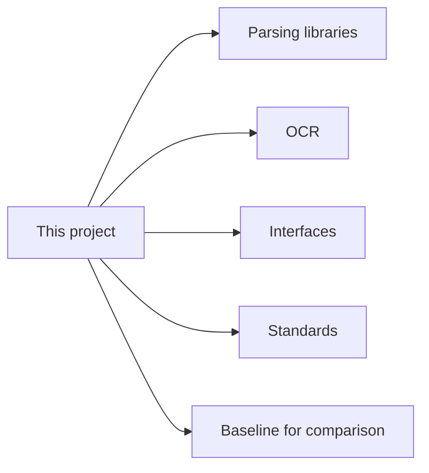

# 14 - References and Acknowledgements

Links were written from memory and were **not re-checked online**; confirm before citing.

## Papers and standards

| Item | Use here |
|---|---|
| R. Smith, "An Overview of the Tesseract OCR Engine", ICDAR 2007 | How the OCR engine works |
| ISO 32000 (PDF) | PDF words, fonts, positions |
| ECMA-376 / ISO 29500 (Office Open XML), including Office Math (OMML) | DOCX, XLSX, PPTX structure; equations |
| CommonMark and GitHub Flavored Markdown specifications | Output format |
| Anthropic documentation on image token cost (about width x height / 750) | Image-versus-text comparison |

## Libraries and tools

| Tool | Role |
|---|---|
| pdfplumber and pdfminer.six | PDF words, geometry, tables |
| pypdfium2 | Rendering PDF pages to images (OCR, figure crops) |
| python-docx | Word files |
| openpyxl | Excel files |
| python-pptx | PowerPoint files |
| Tesseract and pytesseract | OCR |
| Pillow | Image handling |
| BeautifulSoup | HTML |
| PyYAML | YAML |
| Streamlit | Web app |
| FastAPI and uvicorn | HTTP API |
| Ollama | Optional local model for the AI summary |
| reportlab | Generating PDF test samples |
| matplotlib | Charts in the documentation |
| Mermaid and mermaid-cli | Diagrams in the documentation |
| LibreOffice | Optional conversion of old Office formats |
| Docker | Packaging |

## Comparison baseline

Microsoft `markitdown` was used as a baseline in the fidelity evaluation (default settings only).

## Data

No external datasets. All samples are generated by scripts in `scripts/`.

## Palette

Web app colours: Concrete #525871, Warm Steel #857C91, Rosewood #CD9FA0, Peaches & Cream #F2C1A3, Dawn #F8CCAA.

## Acknowledgements

Thanks to the maintainers of the open-source projects above. The project was built with the help of an AI assistant; the code, tests and numbers in these documents were run and checked in the build environment, with the limits stated in [11](11_limitations_and_known_issues.md).

---
Previous: [13 Troubleshooting](13_troubleshooting.md) · Next: [15 Contributors and License](15_contributors_and_license.md)
