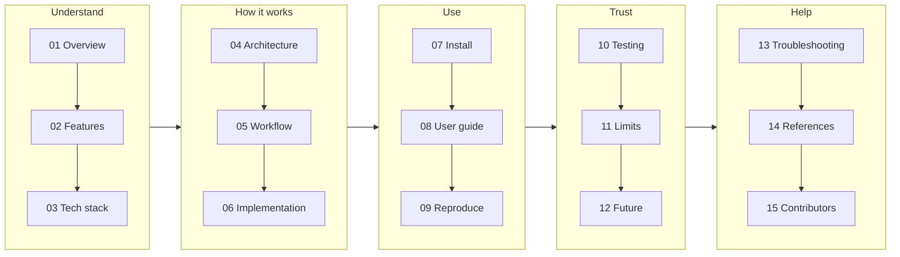

# Documentation

Start here. Fifteen numbered documents explain the project from idea to troubleshooting, in simple English, with Mermaid diagrams. Longer chapters are kept in [deep_dive/](deep_dive/).

| # | Document | Covers |
|---|---|---|
| 01 | [Project Overview](01_project_overview.md) | Summary, motivation, problem, solution, objectives |
| 02 | [Features and Functionalities](02_features_and_functionalities.md) | Feature list, formats, interfaces |
| 03 | [Technology Stack](03_technology_stack.md) | Languages, libraries, why chosen |
| 04 | [System Architecture](04_system_architecture.md) | Diagrams, modules, data flow |
| 05 | [Internal Workflow](05_internal_workflow.md) | Step-by-step operation |
| 06 | [Implementation Details](06_implementation_details.md) | Algorithms, design decisions |
| 07 | [Installation and Setup](07_installation_and_setup.md) | Prerequisites, install, configuration |
| 08 | [User Guide](08_user_guide.md) | Web app, CLI, API, examples |
| 09 | [Reproducibility Guide](09_reproducibility_guide.md) | Exact steps from a clean machine |
| 10 | [Testing and Evaluation](10_testing_and_evaluation.md) | Tests, metrics, results |
| 11 | [Limitations and Known Issues](11_limitations_and_known_issues.md) | What does not work |
| 12 | [Future Improvements](12_future_improvements.md) | Roadmap |
| 13 | [Troubleshooting](13_troubleshooting.md) | Errors, causes, fixes |
| 14 | [References and Acknowledgements](14_references_and_acknowledgements.md) | Sources and tools |
| 15 | [Contributors and License](15_contributors_and_license.md) | People, how to contribute, MIT license |

## Deep dive chapters

| File | Topic |
|---|---|
| [build_from_scratch.md](deep_dive/build_from_scratch.md) | Rebuild the project phase by phase |
| [concepts_and_architecture.md](deep_dive/concepts_and_architecture.md) | Concepts with walkthroughs |
| [conversion_notes.md](deep_dive/conversion_notes.md) | Rules per format |
| [corner_cases.md](deep_dive/corner_cases.md) | 49 awkward inputs and fixes |
| [deployment_free.md](deep_dive/deployment_free.md) | Free hosting options |
| [evaluation_details.md](deep_dive/evaluation_details.md) | Evaluation method in detail |
| [faq_and_interview.md](deep_dive/faq_and_interview.md) | Questions and answers |
| [free_ai_summary_setup.md](deep_dive/free_ai_summary_setup.md) | Optional free AI summary |
| [testing_and_reproduction.md](deep_dive/testing_and_reproduction.md) | Test commands |
| [user_manual.md](deep_dive/user_manual.md) | Long manual |
| [web_app_and_images.md](deep_dive/web_app_and_images.md) | Pages, palette, images and equations |

## Reading paths

- **Quick look:** 01, 02, then 08.
- **Run it:** 07, 08, 09, 13.
- **Understand it:** 04, 05, 06, then `deep_dive/concepts_and_architecture.md`.
- **Learn by rebuilding:** `deep_dive/build_from_scratch.md`, using 09 to check each phase.
- **Present it:** 01, 10, 11, `deep_dive/faq_and_interview.md`.

Images used in the documents are in [assets/](assets/README.md).
